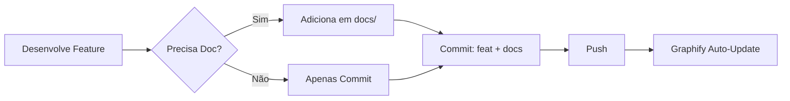
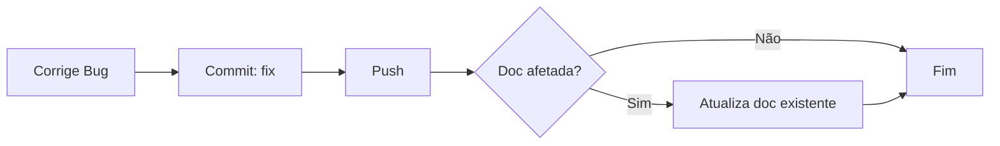
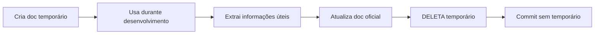

# 📋 Política de Documentação - RunasERP

> Diretrizes para manter documentação limpa, focada e otimizada

---

## 🎯 Princípios Fundamentais

### 1. **Git como Fonte da Verdade**
- Changelog = `git log --oneline`
- Histórico de mudanças = commits
- Releases = tags (`v1.0.0`, `v1.1.0`)

### 2. **Zero Redundância**
- Se está no código, não precisa estar em doc separado
- Se está no commit, não precisa estar em changelog
- Se está obsoleto, deleta (não arquiva)

### 3. **Otimização para Graphify**
- Graphify indexa código e configs, não changelogs
- Docs temporários poluem o grafo de conhecimento
- Mantemos apenas docs que agregam valor técnico

---

## 🗂️ Taxonomia de `docs/`

Toda doc nova entra em **uma** destas nove pastas. Não se cria pasta nova sem
alterar esta política no mesmo commit.

| Pasta | Conteúdo | Arquivos hoje |
|-------|----------|---------------|
| `01-visao-geral/` | README, FAQ, glossário, roadmap | 4 |
| `02-desenvolvimento/` | Guias de desenvolvimento, OAuth, hooks, checklist | 8 |
| `03-arquitetura/` | Visão geral, microsserviços, comunicação, plataforma, persistência | 7 |
| `04-backend/` | Transações de banco e integrações de backend | 3 |
| `05-frontend/` | Estado, dívida arquitetural, design, setup, `plans/`, `audits/` | 19 |
| `06-operacao/` | Runbook de produção, deploy, troubleshooting, pagamentos, seed | 6 |
| `07-legal/` | Documentos jurídicos do produto (EULA) | 1 |
| `10-api-reference/` | Referência de API por serviço + `openapi.yaml` | 11 |
| `11-regras-negocio/` | Regras de negócio por domínio | 6 |

Mais `docs/README.md` e `docs/.docs-policy.md` na raiz de `docs/`: **67 arquivos**
no total (`find docs -type f | wc -l`).

### Por que o salto de `07` para `10`?

Porque renumerar essas duas pastas quebraria **55 referências** espalhadas pelo
repositório: 35 citam a pasta de API (em 16 arquivos) e 20 citam a de regras de
negócio (em 12 arquivos). Conferido em 25/09/2026 com
`grep -rn <pasta> . | grep -v '.claude/worktrees/'`, descontando as ocorrências
dentro da própria pasta e as deste arquivo de política. Caminho estável
vale mais que sequência contígua. `08` e `09` ficam livres para pastas futuras;
a numeração existe para ordenar na listagem, não para ser densa.

---

## ✅ O QUE Documentar

### **Essencial (sempre manter)**

#### 1. Documentação Principal — fica na **RAIZ**, não em `docs/`

Decisão do usuário: os documentos de entrada do projeto moram na raiz do
repositório. Não existe `docs/01-principal/`.

```
README.md                     # Porta de entrada do repositório
O SISTEMA.md                  # Visão geral do produto
QUICK-START.md                # Setup do ambiente de desenvolvimento
FRONTEND_IMPLEMENTACAO.md     # Estado da implementação do frontend
CLAUDE.md                     # Config de ferramenta (o Claude Code lê da raiz)
LICENSE                       # Sem extensão e na raiz: o GitHub só detecta a licença aí
```

O roadmap vive em `docs/01-visao-geral/roadmap.md`.
`docs/07-legal/` guarda documentos jurídicos do produto (hoje `EULA-comercial.md`);
a licença do código **não** vai para lá.

#### 2. Guias Técnicos
```
docs/02-desenvolvimento/
├── README.md
├── CHECKLIST_DESENVOLVIMENTO.md
├── GRAPHIFY_SETUP.md
├── GRAPHIFY_WORKFLOW.md
├── GUIA_MASCARAS_VALIDACOES.md
├── OAUTH_FLUXO_COMPLETO.md
├── OAUTH_PROVIDERS_CONFIG.md
└── SECURITY_HOOKS.md
```

O guia de contribuição fica em `.github/CONTRIBUTING.md` (o GitHub o lê de lá).

#### 3. Arquitetura
```
docs/03-arquitetura/
├── README.md
├── visao-geral.md
├── microsservicos.md
├── comunicacao.md
├── plataforma.md
├── performance-cpu.md
└── persistencia-e-durabilidade.md
```

**Não existe** `docs/03-arquitetura/diagramas/` e esta política não prescreve a
pasta. Diagramas entram no corpo do `.md` a que pertencem.

#### 4. APIs e Regras de Negócio
```
docs/10-api-reference/        # Referência de APIs + openapi.yaml
docs/11-regras-negocio/       # Regras de negócio por domínio
```

#### 5. Operação
```
docs/06-operacao/             # runbook-producao.md, deploy.md, troubleshooting.md,
                              # configuração de meios de pagamento, seed de dados
```

---

## ❌ O QUE NÃO Documentar

### **Proibido (nunca criar)**

#### 1. Changelogs Manuais
```
❌ CHANGELOG_*.md
❌ docs/12-changelog/
❌ docs/03-changelogs/
```
**Por quê?** `git log` já é o changelog automático

#### 2. Documentos Temporários
```
❌ *_TEMP.md
❌ *_WIP.md
❌ *_DRAFT.md
❌ RESUMO_*.md
❌ FINAL_*.md
❌ PRONTO_*.md
❌ TESTAR_*.md
```
**Por quê?** Poluem o repositório e o Graphify

#### 3. Documentos de Debugging
```
❌ BUGFIX_*.md
❌ FIX_*.md
❌ DEBUG_*.md
❌ AUDITORIA_*.md
```
**Por quê?** Bugs são documentados em commits e issues

> **Exceção explícita — `docs/05-frontend/plans/` e `docs/05-frontend/audits/`**
>
> Estas duas pastas estão **em uso ativo pelo usuário** e **não** caem na
> proibição acima. Os arquivos carregam front matter com `status: active`
> (hoje: `audits/AUD-2026-06-29.md` e os quatro `plans/frontend-phase-*.md`).
> Enquanto `status: active`, ninguém edita, move ou deleta esses arquivos —
> nem em faxina de documentação. Mudaram para `status: done`/`archived`?
> Aí sim entram na regra normal e podem ser removidos.

#### 4. Guias de Teste Ad-hoc
```
❌ COMO_TESTAR_*.md
❌ MANUAL_TEST_*.md
❌ GUIA_TESTES_*.md
```
**Por quê?** Testes devem estar em `tests/` (pytest)

#### 5. Archives e Obsoletos
```
❌ docs/_archive/
❌ docs/arquivados/
❌ docs/obsoletos/
```
**Por quê?** Git já é o histórico, docs obsoletos são deletados

---

## 🔄 Workflow de Documentação

### **Para Novas Features**



### **Para Bugfixes**



### **Para Documentação Temporária**



---

## 📝 Exemplos de Uso

### ✅ **BOM**: Usar Git Log

```powershell
# Ver changelog completo
git log --oneline --graph --all

# Ver mudanças desde última release
git log v1.0.0..HEAD --oneline

# Ver mudanças de um módulo
git log --oneline -- services/vendas/

# Gerar changelog para release notes
git log v1.0.0..v1.1.0 --pretty=format:"- %s"
```

### ❌ **RUIM**: Criar Changelogs Manuais

```markdown
# CHANGELOG_NOVA_FEATURE.md  ← NÃO FAZER!

## O que mudou
- Implementado X
- Corrigido Y
- Adicionado Z

## Arquivos modificados
...
```

---

### ✅ **BOM**: Documentar Arquitetura

```markdown
# docs/03-arquitetura/comunicacao.md

## Comunicação entre Microserviços

### Padrão de Request
Os microserviços se comunicam via HTTP REST...

### Fluxo de Vendas
1. API Gateway recebe requisição
2. Valida autenticação
3. Encaminha para serviço de vendas
...
```

### ❌ **RUIM**: Documentar Implementação Trivial

```markdown
# RESUMO_IMPLEMENTACAO_VALIDACAO.md  ← NÃO FAZER!

Hoje implementei validação de CPF no campo X.

Usei a função Y do módulo Z.

Testei e funcionou.
```

---

## 🛡️ `.gitignore` Preventivo

O `.gitignore` está configurado para impedir que documentos temporários **novos**
passem a ser rastreados (bloco "Documentation temporary files (NEW POLICY)",
linhas 83-96):

```gitignore
# Documentation temporary files (NEW POLICY)
*_TEMP.md
*_WIP.md
*_DRAFT.md
CHANGELOG_*.md
BUGFIX_*.md
AUDITORIA_*.md
RESUMO_*.md
FINAL_*.md
PRONTO_*.md
TESTAR_*.md
COMO_*.md
MANUAL_*.md
GUIA_TESTES_*.md
```

---

## 🔍 Auditoria de Documentação

### ⚠️ `.gitignore` **não** protege arquivo já rastreado

Regra aprendida na faxina de setembro/2026: um padrão no `.gitignore` só impede
que o git passe a **rastrear** um arquivo novo. Arquivo que já estava no índice
antes do padrão continua rastreado, continua sendo commitado e continua invisível
para qualquer checagem baseada em `.gitignore`.

Logo, a verificação correta consulta o **índice do git**, não o disco:

```bash
# Verificação mensal - deve retornar VAZIO
git ls-files | grep -E "CHANGELOG_|GUIA_TESTES_|AUDITORIA_|_TEMP\.md|_WIP\.md|_DRAFT\.md|BUGFIX_|RESUMO_|FINAL_|PRONTO_|TESTAR_"
```

Achou alguma linha? O arquivo está rastreado **apesar** do `.gitignore`; só
`git rm --cached <arquivo>` (ou deletar de vez) resolve.

`Get-ChildItem -Recurse -Filter "CHANGELOG*.md"` **não** serve para essa
checagem: ele varre o disco, então acusa arquivo local legitimamente ignorado e
não distingue rastreado de não rastreado.

> Ao grepar o repositório, exclua os worktrees do Claude:
> `| grep -v '.claude/worktrees/'`.

### **Limpeza Semestral**

```powershell
# Listar docs modificados há mais de 6 meses (candidatos a revisão)
Get-ChildItem docs\ -Recurse -Filter "*.md" |
  Where-Object {$_.LastWriteTime -lt (Get-Date).AddMonths(-6)}

# Revisar e deletar obsoletos
```

---

## 📊 Métricas de Qualidade

### **Indicadores de Saúde da Documentação**

Números recontados em 25/09/2026, depois da faxina de documentação.

| Métrica | Meta | Status atual (25/09/2026) | Como medir |
|---------|------|---------------------------|------------|
| Changelogs manuais | 0 | ✅ 0 (`docs/03-changelogs/` foi deletado) | `git ls-files \| grep -E "CHANGELOG_"` |
| Docs temporários rastreados | 0 | ✅ 0 | o `git ls-files \| grep -E ...` da seção de auditoria |
| Archives | 0 | ✅ 0 | `ls docs/_archive docs/arquivados docs/obsoletos` |
| Docs `.md` na raiz | ≤ 5 | ✅ 5 | `ls -1 *.md \| wc -l` |
| Total de arquivos em `docs/` | < 80 | ✅ 67 | `find docs -type f \| wc -l` |
| Graphify nodes | < 8.500 | ✅ 7.210 | `graphify-out/graph.json` |

Os 5 `.md` permitidos na raiz são nominais — não é cota livre:
`README.md`, `O SISTEMA.md`, `QUICK-START.md`, `FRONTEND_IMPLEMENTACAO.md`
(decisão do usuário) e `CLAUDE.md` (config de ferramenta, lida da raiz).
Qualquer `.md` fora dessa lista na raiz é erro. `LICENSE` não tem extensão `.md`
e não entra na conta.

---

## 🚀 Benefícios da Política

1. **Graphify Otimizado**: Menos ruído, mais precisão
2. **Economia de Tokens**: menos docs indexados, menos contexto por query
   *(A CONFIRMAR: o número "30-40%" que constava aqui nunca teve medição
   registrada; só volta com o antes/depois de `rtk gain` ou do relatório do
   Graphify anexado.)*
3. **Manutenibilidade**: Menos arquivos para manter
4. **Clareza**: Docs focados apenas no essencial
5. **Git como SST**: Single Source of Truth

---

## 📞 Dúvidas Frequentes

### **"E se eu precisar documentar um bugfix complexo?"**
→ Use a mensagem de commit detalhada:
```bash
git commit -m "fix(vendas): resolve race condition in stock update

Problema: Múltiplas requisições simultâneas causavam estoque negativo.

Solução:
- Implementado lock pessimista no repository
- Adicionado retry com backoff exponencial
- Atualizado teste de concorrência

Refs: #123"
```

### **"E se eu precisar de notas temporárias durante desenvolvimento?"**
→ Use arquivos locais NÃO rastreados:
```powershell
# Criar nota temporária (ignorada pelo git)
New-Item "NOTAS_TEMP.md"

# Ao finalizar, extraia informações úteis e delete
Remove-Item "NOTAS_TEMP.md"
```

### **"Como faço release notes sem changelog?"**
→ Use git log:
```powershell
# Gerar release notes automaticamente
git log v1.0.0..v1.1.0 --pretty=format:"- %s" > RELEASE_NOTES.txt

# Revise, edite se necessário, publique no GitHub Releases
# Depois delete o arquivo local
Remove-Item RELEASE_NOTES.txt
```

---

<div align="center">

**Política Estabelecida**: Junho 2026  
**Última revisão**: 25 de setembro de 2026 (árvore e métricas recontadas)  
**Revisão**: Semestral  
**Zero Changelogs · Zero Temporários · Zero Archives**

</div>
