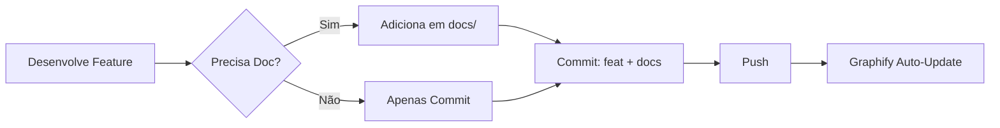
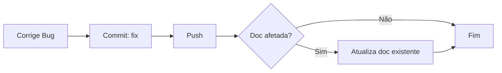
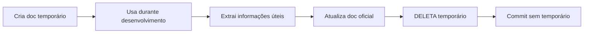

# 📋 Política de Documentação - RunasERP

> Diretrizes para manter documentação limpa, focada e otimizada

---

## 🎯 Princípios Fundamentais

### 1. **Git como Fonte da Verdade**
- Changelog = `git log --oneline`
- Histórico de mudanças = commits
- Releases = tags (`v1.0.0`, `v1.1.0`)

### 2. **Zero Redundância**
- Se está no código, não precisa estar em doc separado
- Se está no commit, não precisa estar em changelog
- Se está obsoleto, deleta (não arquiva)

### 3. **Otimização para Graphify**
- Graphify indexa código e configs, não changelogs
- Docs temporários poluem o grafo de conhecimento
- Mantemos apenas docs que agregam valor técnico

---

## ✅ O QUE Documentar

### **Essencial (sempre manter)**

#### 1. Documentação Principal
```
docs/01-principal/
├── O SISTEMA.md              # Visão geral do projeto
├── QUICK-START.md            # Setup em 5 minutos
├── FEATURES_FUTURAS.md       # Roadmap
└── LICENSE.md                # Licença
```

#### 2. Guias Técnicos
```
docs/02-desenvolvimento/
├── GRAPHIFY_SETUP.md         # Setup de ferramentas
├── GUIA_MASCARAS_VALIDACOES.md
├── OAUTH_FLUXO_COMPLETO.md
└── OAUTH_PROVIDERS_CONFIG.md
```

#### 3. Arquitetura
```
docs/03-arquitetura/
├── README.md                 # Overview da arquitetura
├── comunicacao.md            # Comunicação entre serviços
└── diagramas/                # Diagramas visuais
```

#### 4. APIs e Regras de Negócio
```
docs/10-api-reference/        # Referência completa de APIs
docs/11-regras-negocio/       # Regras de negócio por domínio
```

---

## ❌ O QUE NÃO Documentar

### **Proibido (nunca criar)**

#### 1. Changelogs Manuais
```
❌ CHANGELOG_*.md
❌ docs/12-changelog/
❌ docs/03-changelogs/
```
**Por quê?** `git log` já é o changelog automático

#### 2. Documentos Temporários
```
❌ *_TEMP.md
❌ *_WIP.md
❌ *_DRAFT.md
❌ RESUMO_*.md
❌ FINAL_*.md
❌ PRONTO_*.md
❌ TESTAR_*.md
```
**Por quê?** Poluem o repositório e o Graphify

#### 3. Documentos de Debugging
```
❌ BUGFIX_*.md
❌ FIX_*.md
❌ DEBUG_*.md
❌ AUDITORIA_*.md
```
**Por quê?** Bugs são documentados em commits e issues

#### 4. Guias de Teste Ad-hoc
```
❌ COMO_TESTAR_*.md
❌ MANUAL_TEST_*.md
❌ GUIA_TESTES_*.md
```
**Por quê?** Testes devem estar em `tests/` (pytest)

#### 5. Archives e Obsoletos
```
❌ docs/_archive/
❌ docs/arquivados/
❌ docs/obsoletos/
```
**Por quê?** Git já é o histórico, docs obsoletos são deletados

---

## 🔄 Workflow de Documentação

### **Para Novas Features**



### **Para Bugfixes**



### **Para Documentação Temporária**



---

## 📝 Exemplos de Uso

### ✅ **BOM**: Usar Git Log

```powershell
# Ver changelog completo
git log --oneline --graph --all

# Ver mudanças desde última release
git log v1.0.0..HEAD --oneline

# Ver mudanças de um módulo
git log --oneline -- services/vendas/

# Gerar changelog para release notes
git log v1.0.0..v1.1.0 --pretty=format:"- %s"
```

### ❌ **RUIM**: Criar Changelogs Manuais

```markdown
# CHANGELOG_NOVA_FEATURE.md  ← NÃO FAZER!

## O que mudou
- Implementado X
- Corrigido Y
- Adicionado Z

## Arquivos modificados
...
```

---

### ✅ **BOM**: Documentar Arquitetura

```markdown
# docs/03-arquitetura/comunicacao.md

## Comunicação entre Microserviços

### Padrão de Request
Os microserviços se comunicam via HTTP REST...

### Fluxo de Vendas
1. API Gateway recebe requisição
2. Valida autenticação
3. Encaminha para serviço de vendas
...
```

### ❌ **RUIM**: Documentar Implementação Trivial

```markdown
# RESUMO_IMPLEMENTACAO_VALIDACAO.md  ← NÃO FAZER!

Hoje implementei validação de CPF no campo X.

Usei a função Y do módulo Z.

Testei e funcionou.
```

---

## 🛡️ `.gitignore` Preventivo

O `.gitignore` está configurado para **bloquear automaticamente** documentos temporários:

```gitignore
# Documentation temporary files
*_TEMP.md
*_WIP.md
*_DRAFT.md
CHANGELOG_*.md
BUGFIX_*.md
AUDITORIA_*.md
RESUMO_*.md
FINAL_*.md
PRONTO_*.md
TESTAR_*.md
COMO_*.md
MANUAL_*.md
GUIA_TESTES_*.md
```

---

## 🔍 Auditoria de Documentação

### **Verificação Mensal**

```powershell
# Verificar se há changelogs acidentais
Get-ChildItem -Recurse -Filter "CHANGELOG*.md"

# Deve retornar: 0 arquivos
```

### **Limpeza Semestral**

```powershell
# Listar docs não acessados em 6 meses
Get-ChildItem docs\ -Recurse -Filter "*.md" | 
  Where-Object {$_.LastAccessTime -lt (Get-Date).AddMonths(-6)}

# Revisar e deletar obsoletos
```

---

## 📊 Métricas de Qualidade

### **Indicadores de Saúde da Documentação**

| Métrica | Meta | Status Atual (Jun/2026) |
|---------|------|-------------------------|
| Changelogs manuais | 0 | ✅ 0 |
| Docs temporários | 0 | ✅ 0 |
| Archives | 0 | ✅ 0 |
| Docs na raiz | ≤ 3 | ✅ 3 |
| Total de docs | < 80 | ✅ 75 |
| Graphify nodes | < 8.500 | ✅ ~8.000 |

---

## 🚀 Benefícios da Política

1. **Graphify Otimizado**: Menos ruído, mais precisão
2. **Economia de Tokens**: 30-40% menos tokens por query
3. **Manutenibilidade**: Menos arquivos para manter
4. **Clareza**: Docs focados apenas no essencial
5. **Git como SST**: Single Source of Truth

---

## 📞 Dúvidas Frequentes

### **"E se eu precisar documentar um bugfix complexo?"**
→ Use a mensagem de commit detalhada:
```bash
git commit -m "fix(vendas): resolve race condition in stock update

Problema: Múltiplas requisições simultâneas causavam estoque negativo.

Solução:
- Implementado lock pessimista no repository
- Adicionado retry com backoff exponencial
- Atualizado teste de concorrência

Refs: #123"
```

### **"E se eu precisar de notas temporárias durante desenvolvimento?"**
→ Use arquivos locais NÃO rastreados:
```powershell
# Criar nota temporária (ignorada pelo git)
New-Item "NOTAS_TEMP.md"

# Ao finalizar, extraia informações úteis e delete
Remove-Item "NOTAS_TEMP.md"
```

### **"Como faço release notes sem changelog?"**
→ Use git log:
```powershell
# Gerar release notes automaticamente
git log v1.0.0..v1.1.0 --pretty=format:"- %s" > RELEASE_NOTES.txt

# Revise, edite se necessário, publique no GitHub Releases
# Depois delete o arquivo local
Remove-Item RELEASE_NOTES.txt
```

---

<div align="center">

**Política Estabelecida**: Junho 2026  
**Revisão**: Semestral  
**Zero Changelogs · Zero Temporários · Zero Archives**

</div>
