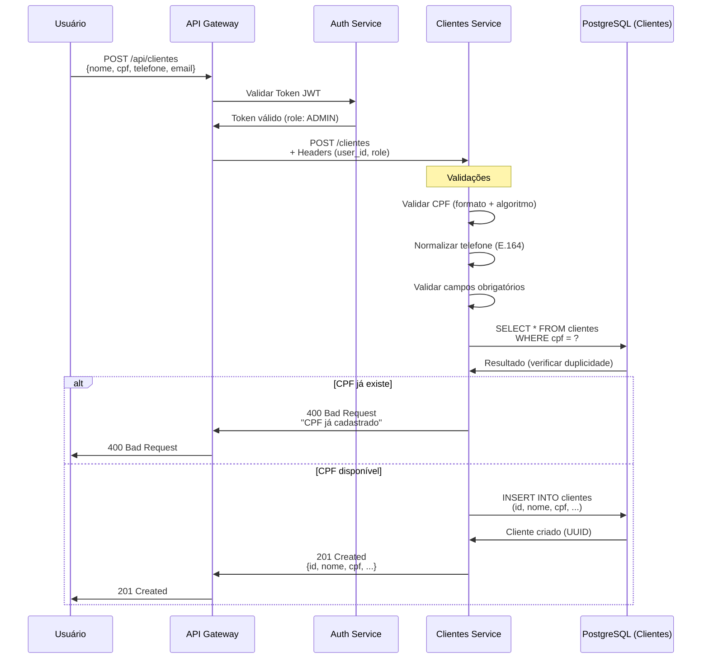
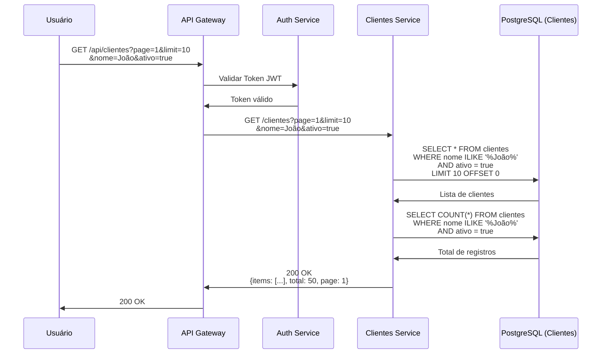
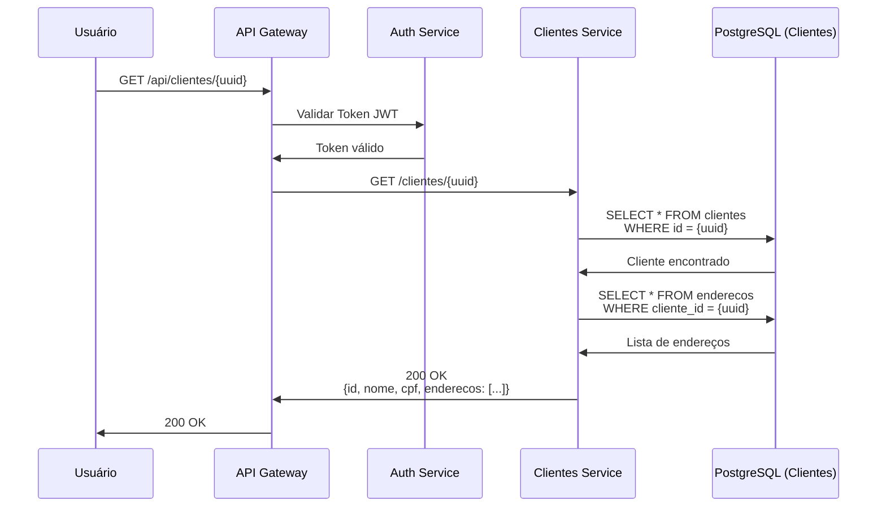
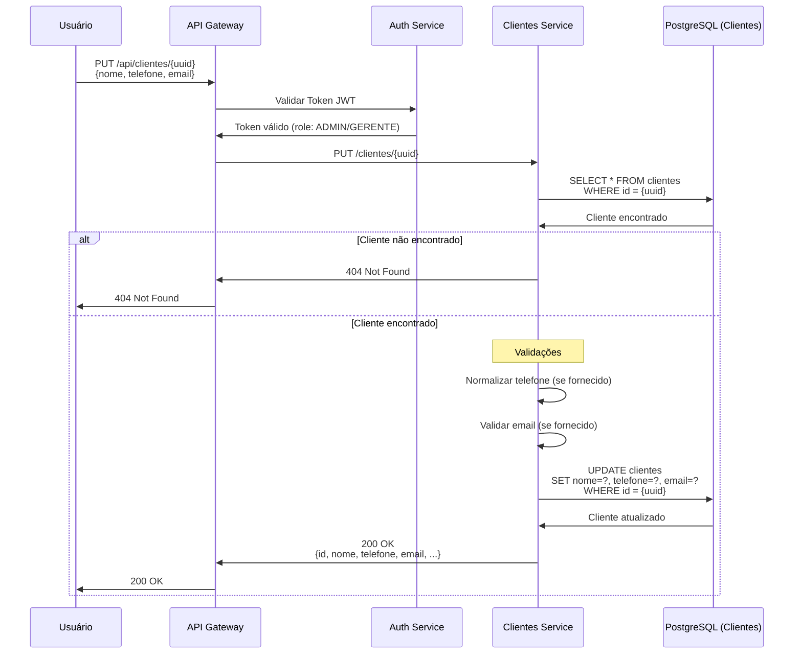
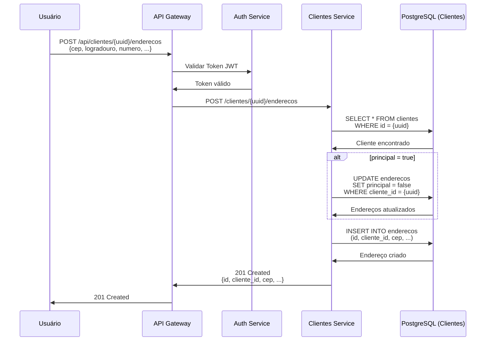
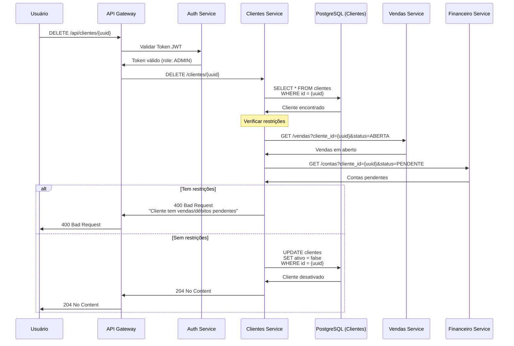

# 👥 Diagramas de Sequência - Clientes

**Data**: 26 de Maio de 2026  
**Versão**: 2.0.0  
**Domínio**: Clientes

---

## 📑 Índice

1. [Criar Cliente](#11-criar-cliente)
2. [Listar Clientes](#12-listar-clientes)
3. [Buscar Cliente por ID](#13-buscar-cliente-por-id)
4. [Atualizar Cliente](#14-atualizar-cliente)
5. [Adicionar Endereço](#15-adicionar-endereço)
6. [Desativar Cliente](#16-desativar-cliente)

---

## 1.1. Criar Cliente (POST /api/clientes)



### Validações Aplicadas

- **CPF**: Formato (11 dígitos) + Algoritmo de validação
- **Telefone**: Normalização para formato E.164 (+5511999999999)
- **Email**: Formato válido de email
- **Campos obrigatórios**: nome, cpf_cnpj, tipo (PESSOA_FISICA/PESSOA_JURIDICA)

### Regras de Negócio

- CPF/CNPJ deve ser único no sistema
- Telefone é normalizado automaticamente
- Cliente criado com status `ativo = true` por padrão
- Crédito inicial pode ser definido (padrão: 0)

---

## 1.2. Listar Clientes (GET /api/clientes)



### Filtros Disponíveis

- `nome` - Busca parcial (case-insensitive)
- `cpf_cnpj` - Busca exata
- `email` - Busca parcial
- `telefone` - Busca parcial
- `tipo` - PESSOA_FISICA ou PESSOA_JURIDICA
- `ativo` - true/false
- `page` - Número da página (padrão: 1)
- `limit` - Itens por página (padrão: 10, máx: 100)

### Resposta Paginada

```json
{
  "items": [
    {
      "id": "uuid",
      "nome": "João Silva",
      "cpf_cnpj": "12345678901",
      "email": "joao@example.com",
      "telefone": "+5511999999999",
      "tipo": "PESSOA_FISICA",
      "ativo": true,
      "credito_disponivel": 500.00
    }
  ],
  "total": 50,
  "page": 1,
  "limit": 10,
  "pages": 5
}
```

---

## 1.3. Buscar Cliente por ID (GET /api/clientes/{id})



### Resposta Detalhada

```json
{
  "id": "uuid",
  "nome": "João Silva",
  "cpf_cnpj": "12345678901",
  "email": "joao@example.com",
  "telefone": "+5511999999999",
  "tipo": "PESSOA_FISICA",
  "ativo": true,
  "credito_disponivel": 500.00,
  "credito_utilizado": 200.00,
  "credito_total": 700.00,
  "enderecos": [
    {
      "id": "uuid",
      "cep": "01310-100",
      "logradouro": "Av. Paulista",
      "numero": "1000",
      "complemento": "Apto 101",
      "bairro": "Bela Vista",
      "cidade": "São Paulo",
      "estado": "SP",
      "principal": true
    }
  ],
  "criado_em": "2026-05-26T10:00:00Z",
  "atualizado_em": "2026-05-26T10:00:00Z"
}
```

---

## 1.4. Atualizar Cliente (PUT /api/clientes/{id})



### Campos Atualizáveis

- `nome` - Nome completo
- `email` - Email de contato
- `telefone` - Telefone principal
- `credito_total` - Limite de crédito (apenas ADMIN)
- `ativo` - Status do cliente (apenas ADMIN)

### Campos NÃO Atualizáveis

- `cpf_cnpj` - Imutável após criação
- `tipo` - Imutável após criação
- `credito_disponivel` - Calculado automaticamente
- `credito_utilizado` - Atualizado via vendas/pagamentos

---

## 1.5. Adicionar Endereço (POST /api/clientes/{id}/enderecos)



### Regras de Endereço

- Cliente pode ter múltiplos endereços
- Apenas um endereço pode ser marcado como `principal`
- Ao marcar novo endereço como principal, o anterior é desmarcado automaticamente
- Primeiro endereço é automaticamente marcado como principal
- CEP é validado (formato: 00000-000)

### Campos do Endereço

```json
{
  "cep": "01310-100",
  "logradouro": "Av. Paulista",
  "numero": "1000",
  "complemento": "Apto 101",
  "bairro": "Bela Vista",
  "cidade": "São Paulo",
  "estado": "SP",
  "principal": true
}
```

---

## 1.6. Desativar Cliente (DELETE /api/clientes/{id})



### Regras de Desativação

**Soft Delete**: Cliente não é excluído fisicamente, apenas marcado como `ativo = false`

**Restrições que impedem desativação:**
- Vendas em aberto (status: PENDENTE, AGUARDANDO_PAGAMENTO)
- Contas a receber pendentes
- Crédito utilizado > 0

**Após desativação:**
- Cliente não aparece em listagens (filtro padrão: ativo=true)
- Não pode realizar novas compras
- Histórico de vendas é mantido
- Pode ser reativado por ADMIN

### Reativar Cliente

```http
PUT /api/clientes/{uuid}
{
  "ativo": true
}
```

---

## 📊 Resumo de Endpoints

| Método | Endpoint | Descrição | Permissão |
|--------|----------|-----------|-----------|
| POST | `/api/clientes` | Criar cliente | ADMIN |
| GET | `/api/clientes` | Listar clientes | Todos |
| GET | `/api/clientes/{id}` | Buscar por ID | Todos |
| PUT | `/api/clientes/{id}` | Atualizar cliente | ADMIN/GERENTE |
| DELETE | `/api/clientes/{id}` | Desativar cliente | ADMIN |
| POST | `/api/clientes/{id}/enderecos` | Adicionar endereço | Todos |
| PUT | `/api/clientes/{id}/enderecos/{endereco_id}` | Atualizar endereço | Todos |
| DELETE | `/api/clientes/{id}/enderecos/{endereco_id}` | Remover endereço | Todos |

---

## 🔐 Permissões por Role

| Operação | ADMIN | GERENTE | VENDEDOR | OPERADOR |
|----------|-------|---------|----------|----------|
| Criar cliente | ✅ | ❌ | ❌ | ❌ |
| Listar clientes | ✅ | ✅ | ✅ | ✅ |
| Buscar cliente | ✅ | ✅ | ✅ | ✅ |
| Atualizar cliente | ✅ | ✅ | ❌ | ❌ |
| Desativar cliente | ✅ | ❌ | ❌ | ❌ |
| Gerenciar endereços | ✅ | ✅ | ✅ | ❌ |
| Alterar crédito | ✅ | ❌ | ❌ | ❌ |

---

## 📚 Documentação Relacionada

- **[Regras de Negócio - Clientes](../../../11-regras-negocio/clientes.md)** - Regras detalhadas
- **[API Reference - Clientes](../../../10-api-reference/mapeamento-rotas.md#clientes)** - Referência completa
- **[Fluxos Integrados](./fluxos-integrados.md)** - Fluxos que envolvem clientes
- **[Índice Geral](./README.md)** - Voltar ao índice

---

**Última atualização**: 26 de Maio de 2026  
**Versão**: 2.0.0  
**Mantido por**: Equipe DenebCorp

---

<div align="center">

**[⬆ Voltar ao topo](#-diagramas-de-sequência---clientes)**

</div>
