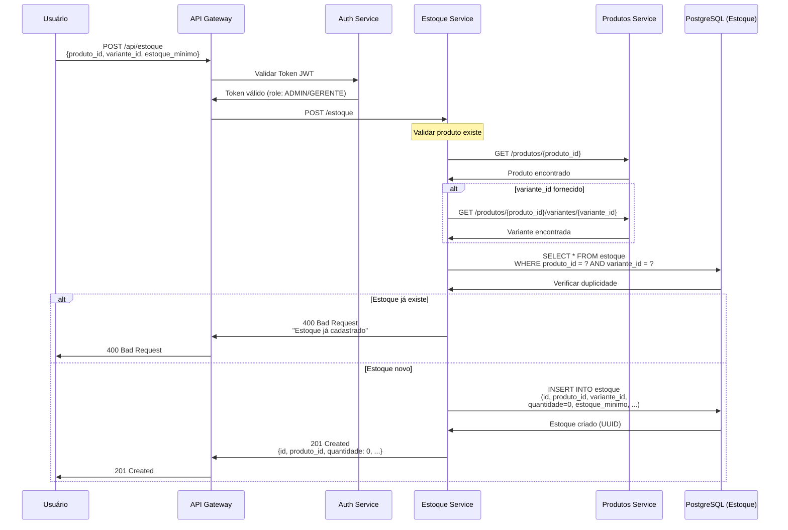
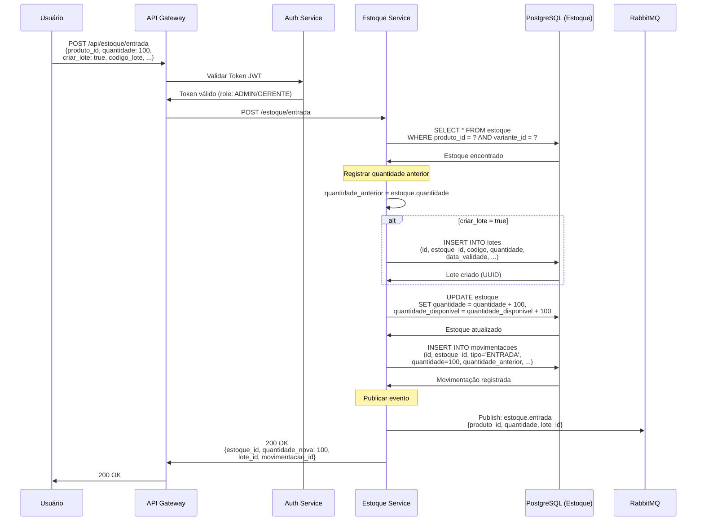
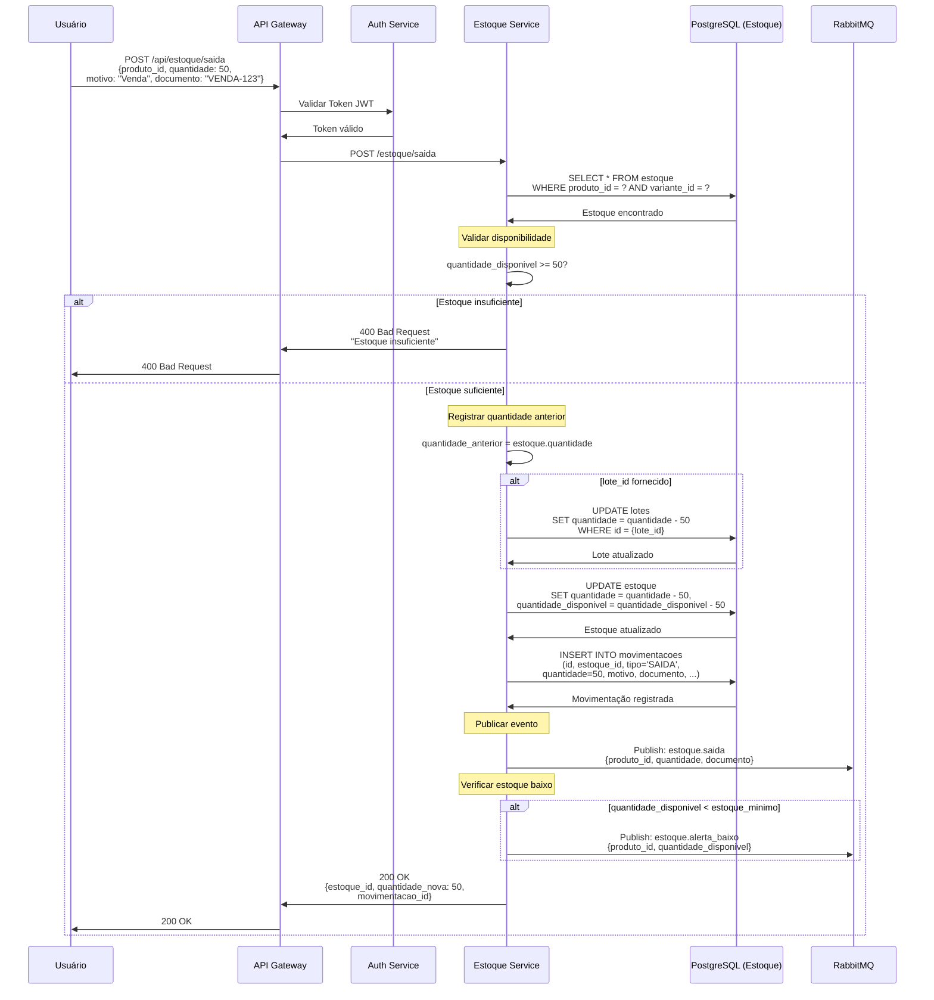
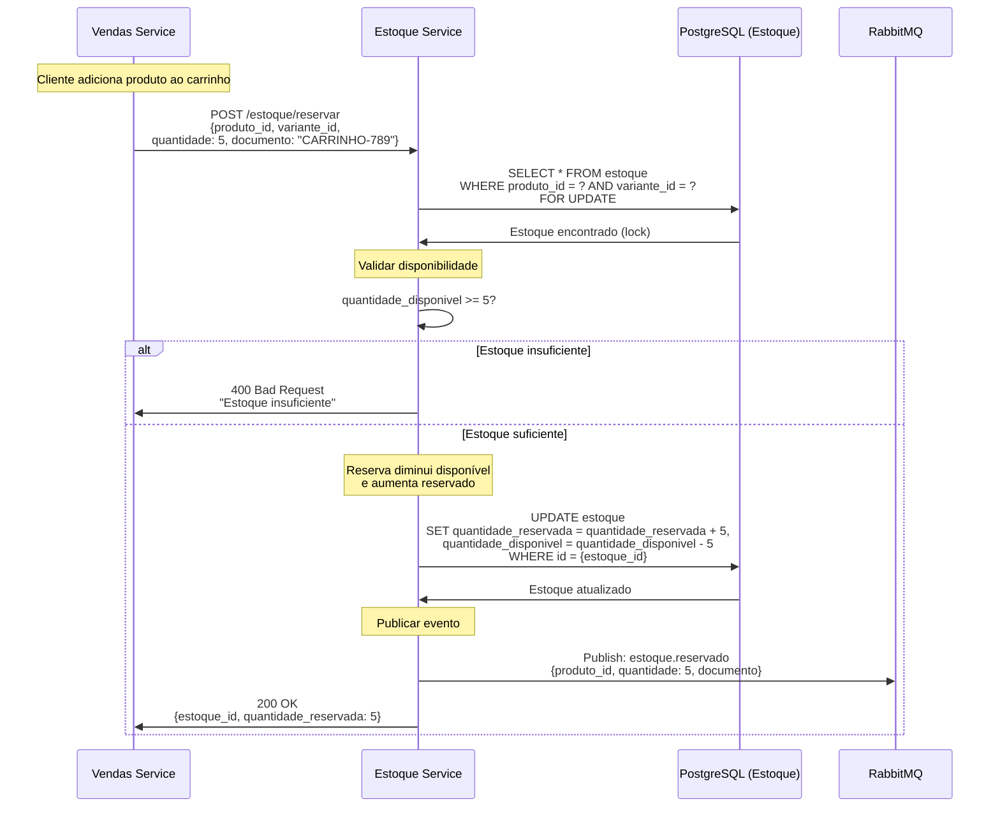
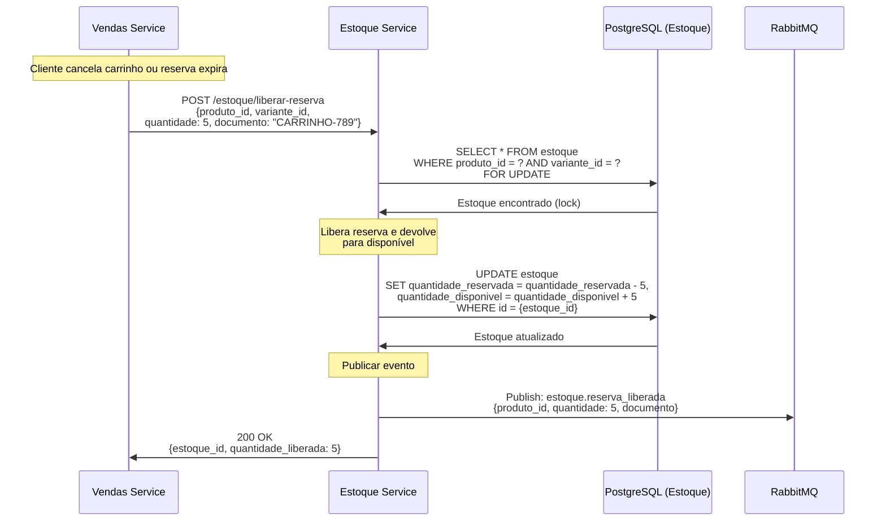
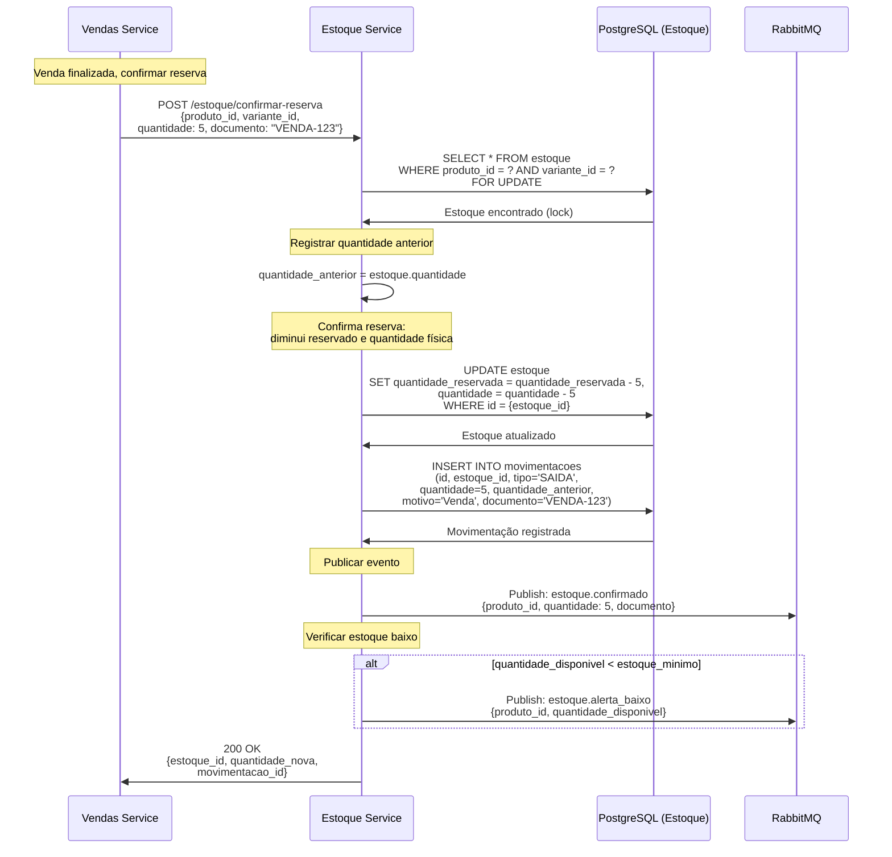
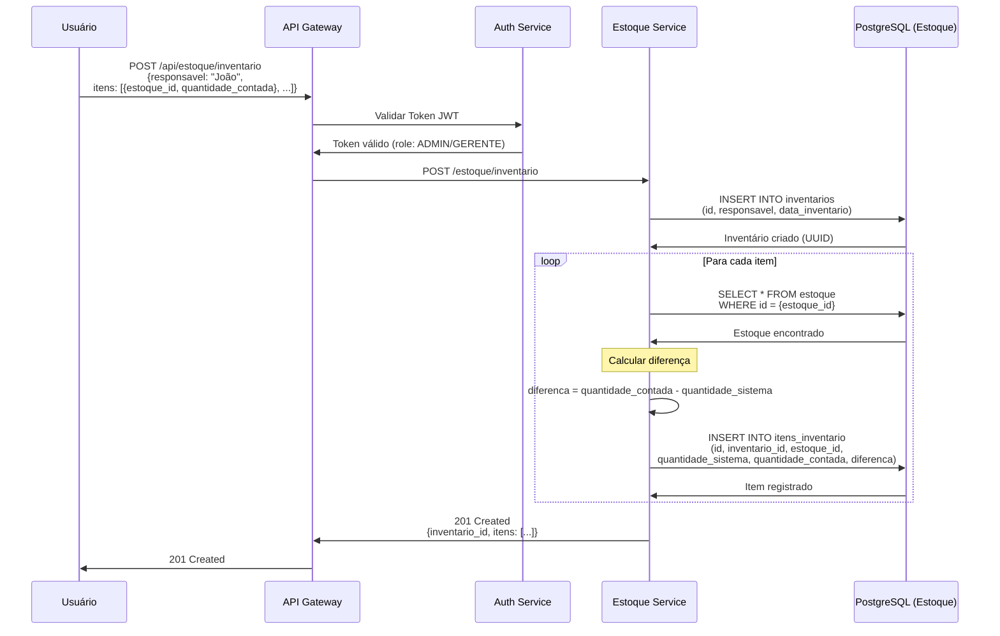
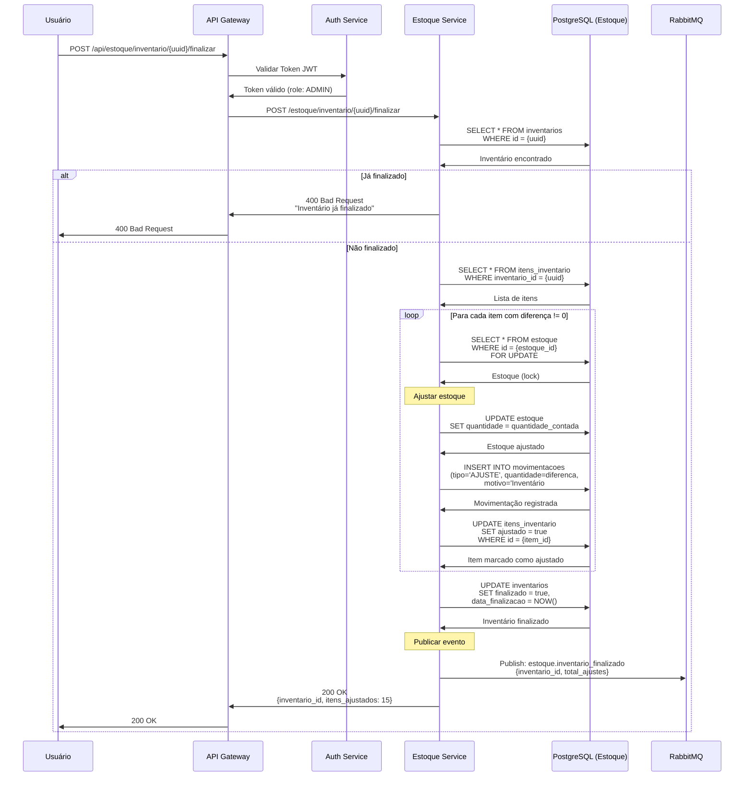

# 📊 Diagramas de Sequência - Estoque

**Data**: 26 de Maio de 2026  
**Versão**: 2.0.0  
**Domínio**: Estoque

---

## 📑 Índice

1. [Criar Registro de Estoque](#31-criar-registro-de-estoque)
2. [Entrada de Estoque](#32-entrada-de-estoque)
3. [Saída de Estoque](#33-saída-de-estoque)
4. [Reservar Estoque](#34-reservar-estoque)
5. [Liberar Reserva](#35-liberar-reserva)
6. [Confirmar Reserva](#36-confirmar-reserva)
7. [Realizar Inventário](#37-realizar-inventário)
8. [Finalizar Inventário e Ajustar](#38-finalizar-inventário-e-ajustar-estoque)

---

## 3.1. Criar Registro de Estoque (POST /api/estoque)



### Campos do Estoque

```json
{
  "produto_id": "uuid",
  "variante_id": "uuid",
  "quantidade": 0,
  "quantidade_reservada": 0,
  "quantidade_disponivel": 0,
  "estoque_minimo": 10,
  "estoque_maximo": 100,
  "localizacao": "A1-P2-N3"
}
```

### Regras de Negócio

- Cada produto/variante tem apenas um registro de estoque
- Quantidade inicial é sempre 0
- `quantidade_disponivel = quantidade - quantidade_reservada`
- Estoque mínimo define quando enviar alerta
- Localização ajuda na organização física do depósito

---

## 3.2. Entrada de Estoque (POST /api/estoque/entrada)



### Entrada com Lote

**Quando usar lotes?**
- Produtos perecíveis (alimentos, bebidas)
- Produtos com validade (medicamentos, cosméticos)
- Controle de qualidade por fornecedor
- Rastreabilidade (recall de produtos)

**Exemplo de Lote**:
```json
{
  "codigo_lote": "LOTE-2026-05-001",
  "data_fabricacao": "2026-05-01",
  "data_validade": "2026-11-01",
  "fornecedor_id": "uuid",
  "nota_fiscal": "NF-12345",
  "quantidade": 100
}
```

### Tipos de Entrada

1. **Compra de Fornecedor**: Entrada normal com nota fiscal
2. **Devolução de Cliente**: Entrada por devolução
3. **Transferência entre Depósitos**: Entrada em um, saída em outro
4. **Ajuste de Inventário**: Correção após contagem

---

## 3.3. Saída de Estoque (POST /api/estoque/saida)



### Tipos de Saída

1. **Venda**: Saída por venda ao cliente
2. **Perda**: Produto vencido, danificado ou roubado
3. **Transferência**: Saída para outro depósito
4. **Devolução ao Fornecedor**: Produto com defeito
5. **Consumo Interno**: Uso interno da empresa
6. **Ajuste de Inventário**: Correção após contagem

### Motivos de Saída

```json
{
  "tipo": "SAIDA",
  "motivo": "Venda",
  "documento": "VENDA-123",
  "quantidade": 50,
  "observacao": "Venda realizada no balcão"
}
```

---

## 3.4. Reservar Estoque (POST /api/estoque/reservar)



### Como Funciona a Reserva?

**Estado Inicial**:
```
quantidade = 100
quantidade_reservada = 0
quantidade_disponivel = 100
```

**Após Reservar 5 unidades**:
```
quantidade = 100 (não muda)
quantidade_reservada = 5 (aumenta)
quantidade_disponivel = 95 (diminui)
```

**Fórmula**:
```
quantidade_disponivel = quantidade - quantidade_reservada
```

### Quando Usar Reserva?

- ✅ **Carrinho de compras**: Reserva enquanto cliente decide
- ✅ **Orçamento**: Reserva para garantir disponibilidade
- ✅ **Pedido pendente**: Reserva até confirmação de pagamento
- ❌ **Venda finalizada**: Usar confirmar reserva (baixa física)

### Expiração de Reservas

Reservas devem ter TTL (Time To Live):
- Carrinho: 2 horas
- Orçamento: 24 horas
- Pedido: Até confirmação de pagamento

Job agendado libera reservas expiradas automaticamente.

---

## 3.5. Liberar Reserva (POST /api/estoque/liberar-reserva)



### Quando Liberar Reserva?

1. **Cliente cancela carrinho**: Libera imediatamente
2. **Reserva expira**: Job agendado libera automaticamente
3. **Pagamento recusado**: Libera após falha no pagamento
4. **Cliente remove item**: Libera item específico

### Fluxo Completo

```
1. Reservar (carrinho):
   quantidade = 100
   quantidade_reservada = 5
   quantidade_disponivel = 95

2. Liberar (cancelamento):
   quantidade = 100 (não muda)
   quantidade_reservada = 0 (volta a 0)
   quantidade_disponivel = 100 (volta ao normal)
```

---

## 3.6. Confirmar Reserva (POST /api/estoque/confirmar-reserva)



### Diferença: Reservar vs Confirmar

| Operação | quantidade | quantidade_reservada | quantidade_disponivel |
|----------|------------|---------------------|----------------------|
| **Estado Inicial** | 100 | 0 | 100 |
| **Reservar 5** | 100 | 5 | 95 |
| **Confirmar 5** | 95 | 0 | 95 |

**Confirmar Reserva**:
- Diminui `quantidade` física (baixa real)
- Diminui `quantidade_reservada` (libera reserva)
- `quantidade_disponivel` não muda (já estava descontada)
- Cria movimentação de SAÍDA
- **Evita baixa dupla de estoque!**

---

## 3.7. Realizar Inventário (POST /api/estoque/inventario)



### Processo de Inventário

**Fase 1: Contagem Física**
1. Responsável conta fisicamente os produtos
2. Registra quantidade contada no sistema
3. Sistema calcula diferença automaticamente

**Fase 2: Análise**
- Revisar itens com diferença
- Investigar causas (perda, roubo, erro de registro)
- Decidir se ajusta ou reconta

**Fase 3: Finalização**
- Finalizar inventário (próximo diagrama)
- Sistema ajusta estoque automaticamente
- Gera relatório de ajustes

### Exemplo de Inventário

```json
{
  "id": "uuid",
  "responsavel": "João Silva",
  "data_inventario": "2026-05-26T10:00:00Z",
  "finalizado": false,
  "itens": [
    {
      "estoque_id": "uuid-coca-2l",
      "produto_nome": "Coca-Cola 2L",
      "quantidade_sistema": 100,
      "quantidade_contada": 98,
      "diferenca": -2,
      "observacao": "2 unidades danificadas"
    },
    {
      "estoque_id": "uuid-guarana-2l",
      "produto_nome": "Guaraná 2L",
      "quantidade_sistema": 50,
      "quantidade_contada": 52,
      "diferenca": +2,
      "observacao": "Entrada não registrada"
    }
  ]
}
```

---

## 3.8. Finalizar Inventário e Ajustar Estoque (POST /api/estoque/inventario/{id}/finalizar)



### Ajustes Automáticos

**Para cada item com diferença**:
1. Atualiza `quantidade` para `quantidade_contada`
2. Cria movimentação tipo `AJUSTE`
3. Marca item como `ajustado = true`

**Exemplo**:
```
Sistema: 100 unidades
Contado: 98 unidades
Diferença: -2

Ajuste:
- quantidade: 100 → 98
- Movimentação: AJUSTE, -2, "Inventário #123"
```

### Relatório de Inventário

```json
{
  "inventario_id": "uuid",
  "responsavel": "João Silva",
  "data_inicio": "2026-05-26T10:00:00Z",
  "data_finalizacao": "2026-05-26T14:30:00Z",
  "total_itens": 150,
  "itens_ajustados": 15,
  "ajustes": {
    "positivos": 5,
    "negativos": 10,
    "valor_total_ajustes": -250.00
  }
}
```

---

## 📊 Resumo de Endpoints

| Método | Endpoint | Descrição | Permissão |
|--------|----------|-----------|-----------|
| POST | `/api/estoque` | Criar registro | ADMIN/GERENTE |
| GET | `/api/estoque` | Listar estoque | Todos |
| POST | `/api/estoque/entrada` | Entrada | ADMIN/GERENTE |
| POST | `/api/estoque/saida` | Saída direta | ADMIN/GERENTE |
| POST | `/api/estoque/reservar` | Reservar | Sistema |
| POST | `/api/estoque/liberar-reserva` | Liberar | Sistema |
| POST | `/api/estoque/confirmar-reserva` | Confirmar | Sistema |
| POST | `/api/estoque/inventario` | Criar inventário | ADMIN/GERENTE |
| POST | `/api/estoque/inventario/{id}/finalizar` | Finalizar | ADMIN |

---

## 🔐 Permissões por Role

| Operação | ADMIN | GERENTE | VENDEDOR | OPERADOR |
|----------|-------|---------|----------|----------|
| Criar estoque | ✅ | ✅ | ❌ | ❌ |
| Consultar estoque | ✅ | ✅ | ✅ | ✅ |
| Entrada | ✅ | ✅ | ❌ | ❌ |
| Saída direta | ✅ | ✅ | ❌ | ❌ |
| Inventário | ✅ | ✅ | ❌ | ❌ |
| Finalizar inventário | ✅ | ❌ | ❌ | ❌ |
| Reservas | Sistema | Sistema | Sistema | Sistema |

---

## 📚 Documentação Relacionada

- **[Regras de Negócio - Estoque](../../../11-regras-negocio/estoque.md)** - Regras detalhadas
- **[API Reference - Estoque](../../../10-api-reference/mapeamento-rotas.md#estoque)** - Referência completa
- **[Vendas](./vendas.md)** - Como vendas interagem com estoque
- **[Fluxos Integrados](./fluxos-integrados.md)** - Fluxos completos
- **[Índice Geral](./README.md)** - Voltar ao índice

---

**Última atualização**: 26 de Maio de 2026  
**Versão**: 2.0.0  
**Mantido por**: Equipe DenebCorp

---

<div align="center">

**[⬆ Voltar ao topo](#-diagramas-de-sequência---estoque)**

</div>
