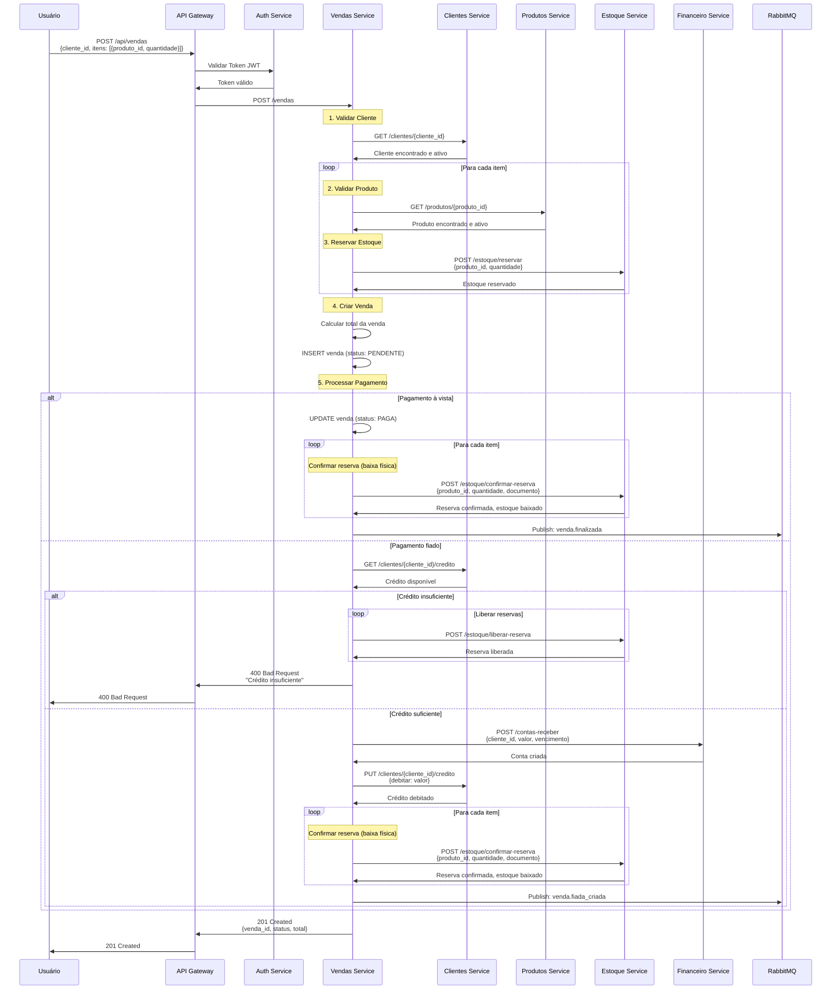
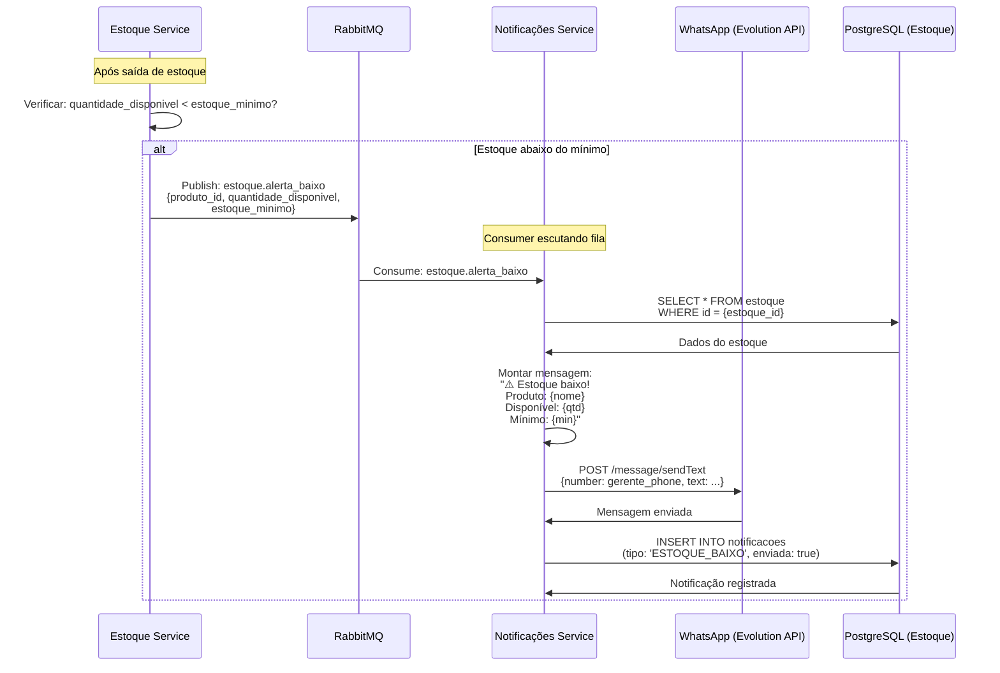
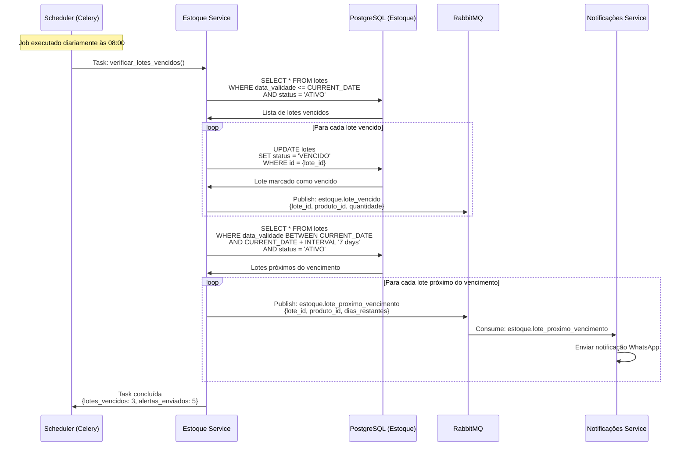

# 🔄 Diagramas de Sequência - Fluxos Integrados

**Data**: 26 de Maio de 2026  
**Versão**: 2.0.0  
**Domínio**: Fluxos que envolvem múltiplos serviços

---

## 📑 Índice

1. [Fluxo Completo: Criar Venda com Estoque](#41-fluxo-completo-criar-venda-com-estoque)
2. [Fluxo: Alerta de Estoque Baixo com Notificação](#42-fluxo-alerta-de-estoque-baixo-com-notificação)
3. [Fluxo: Verificação de Lotes Vencidos (Job Agendado)](#43-fluxo-verificação-de-lotes-vencidos-job-agendado)

---

## 4.1. Fluxo Completo: Criar Venda com Estoque

Este é o fluxo mais complexo do sistema, envolvendo **5 microsserviços** e demonstrando a orquestração completa de uma venda.



### Serviços Envolvidos

| Serviço | Responsabilidade |
|---------|------------------|
| **API Gateway** | Autenticação e roteamento |
| **Auth Service** | Validação de token JWT |
| **Vendas Service** | Orquestração da venda |
| **Clientes Service** | Validação de cliente e crédito |
| **Produtos Service** | Validação de produtos |
| **Estoque Service** | Reserva e confirmação de estoque |
| **Financeiro Service** | Criação de conta a receber |
| **RabbitMQ** | Publicação de eventos |

### Pontos de Falha e Rollback

**Se falhar na validação de cliente**:
- ❌ Retorna erro 400
- ✅ Nenhum rollback necessário (nada foi alterado)

**Se falhar na reserva de estoque**:
- ❌ Retorna erro 400
- ✅ Libera reservas já feitas dos itens anteriores

**Se falhar no crédito (fiado)**:
- ❌ Retorna erro 400
- ✅ Libera todas as reservas de estoque
- ✅ Marca venda como CANCELADA

**Se falhar após criar conta a receber**:
- ❌ Situação crítica
- ⚠️ Requer compensação manual ou Saga Pattern

### Exemplo de Request

```json
{
  "cliente_id": "uuid",
  "forma_pagamento": "FIADO",
  "itens": [
    {
      "produto_id": "uuid-coca-2l",
      "variante_id": "uuid",
      "quantidade": 2,
      "preco_unitario": 8.00
    },
    {
      "produto_id": "uuid-guarana-2l",
      "quantidade": 1,
      "preco_unitario": 7.00
    }
  ],
  "observacao": "Entregar após 18h"
}
```

### Exemplo de Response

```json
{
  "venda_id": "uuid",
  "cliente_id": "uuid",
  "status": "CONFIRMADA",
  "forma_pagamento": "FIADO",
  "total": 23.00,
  "itens": [
    {
      "produto_nome": "Coca-Cola 2L",
      "quantidade": 2,
      "preco_unitario": 8.00,
      "subtotal": 16.00
    },
    {
      "produto_nome": "Guaraná 2L",
      "quantidade": 1,
      "preco_unitario": 7.00,
      "subtotal": 7.00
    }
  ],
  "conta_receber_id": "uuid",
  "vencimento": "2026-06-26",
  "criada_em": "2026-05-26T10:00:00Z"
}
```

---

## 4.2. Fluxo: Alerta de Estoque Baixo com Notificação

Este fluxo demonstra a **comunicação assíncrona** via eventos RabbitMQ e a integração com o serviço de notificações.



### Arquitetura Event-Driven

**Vantagens**:
- ✅ **Desacoplamento**: Estoque não conhece Notificações
- ✅ **Assíncrono**: Não bloqueia a venda
- ✅ **Escalável**: Múltiplos consumers podem processar
- ✅ **Resiliente**: Retry automático em caso de falha

**Desvantagens**:
- ⚠️ **Eventual Consistency**: Notificação pode atrasar
- ⚠️ **Complexidade**: Mais difícil de debugar
- ⚠️ **Duplicação**: Pode enviar notificação duplicada

### Configuração do Consumer

```python
# notificacoes/consumers/estoque_consumer.py

@celery.task
def processar_alerta_estoque_baixo(evento):
    """
    Processa evento de estoque baixo e envia notificação
    """
    produto_id = evento['produto_id']
    quantidade_disponivel = evento['quantidade_disponivel']
    estoque_minimo = evento['estoque_minimo']
    
    # Buscar dados do produto
    produto = produtos_service.get_produto(produto_id)
    
    # Montar mensagem
    mensagem = f"""
    ⚠️ *ALERTA DE ESTOQUE BAIXO*
    
    Produto: {produto.nome}
    Disponível: {quantidade_disponivel} unidades
    Mínimo: {estoque_minimo} unidades
    
    ⚡ Ação necessária: Solicitar reposição
    """
    
    # Enviar para gerentes
    gerentes = usuarios_service.get_usuarios_por_role('GERENTE')
    for gerente in gerentes:
        whatsapp_service.enviar_mensagem(
            numero=gerente.telefone,
            mensagem=mensagem
        )
    
    # Registrar notificação
    notificacoes_repository.criar(
        tipo='ESTOQUE_BAIXO',
        produto_id=produto_id,
        enviada=True
    )
```

### Exemplo de Mensagem WhatsApp

```
⚠️ *ALERTA DE ESTOQUE BAIXO*

Produto: Coca-Cola 2L
Disponível: 8 unidades
Mínimo: 10 unidades

⚡ Ação necessária: Solicitar reposição

---
Sistema Runas
26/05/2026 10:15
```

---

## 4.3. Fluxo: Verificação de Lotes Vencidos (Job Agendado)

Este fluxo demonstra o uso de **jobs agendados** (Celery Beat) para tarefas periódicas.



### Configuração do Celery Beat

```python
# celerybeat-schedule.py

from celery.schedules import crontab

CELERY_BEAT_SCHEDULE = {
    'verificar-lotes-vencidos': {
        'task': 'estoque.tasks.verificar_lotes_vencidos',
        'schedule': crontab(hour=8, minute=0),  # Diariamente às 08:00
    },
    'limpar-carrinhos-expirados': {
        'task': 'vendas.tasks.limpar_carrinhos_expirados',
        'schedule': crontab(minute='*/30'),  # A cada 30 minutos
    },
    'liberar-reservas-expiradas': {
        'task': 'estoque.tasks.liberar_reservas_expiradas',
        'schedule': crontab(minute='*/15'),  # A cada 15 minutos
    },
    'enviar-lembretes-cobranca': {
        'task': 'financeiro.tasks.enviar_lembretes_cobranca',
        'schedule': crontab(hour=9, minute=0),  # Diariamente às 09:00
    },
}
```

### Task de Verificação de Lotes

```python
# estoque/tasks.py

@celery.task
def verificar_lotes_vencidos():
    """
    Verifica lotes vencidos e próximos do vencimento
    Executado diariamente às 08:00
    """
    hoje = date.today()
    daqui_7_dias = hoje + timedelta(days=7)
    
    # 1. Marcar lotes vencidos
    lotes_vencidos = lotes_repository.buscar_por_data_validade(
        data_ate=hoje,
        status='ATIVO'
    )
    
    for lote in lotes_vencidos:
        lotes_repository.atualizar_status(lote.id, 'VENCIDO')
        
        # Publicar evento
        rabbitmq.publish(
            exchange='estoque',
            routing_key='lote.vencido',
            body={
                'lote_id': str(lote.id),
                'produto_id': str(lote.produto_id),
                'quantidade': lote.quantidade,
                'data_validade': lote.data_validade.isoformat()
            }
        )
    
    # 2. Alertar lotes próximos do vencimento
    lotes_proximos = lotes_repository.buscar_por_data_validade(
        data_de=hoje + timedelta(days=1),
        data_ate=daqui_7_dias,
        status='ATIVO'
    )
    
    for lote in lotes_proximos:
        dias_restantes = (lote.data_validade - hoje).days
        
        # Publicar evento
        rabbitmq.publish(
            exchange='estoque',
            routing_key='lote.proximo_vencimento',
            body={
                'lote_id': str(lote.id),
                'produto_id': str(lote.produto_id),
                'quantidade': lote.quantidade,
                'dias_restantes': dias_restantes
            }
        )
    
    return {
        'lotes_vencidos': len(lotes_vencidos),
        'alertas_enviados': len(lotes_proximos)
    }
```

### Exemplo de Notificação

```
🚨 *LOTE PRÓXIMO DO VENCIMENTO*

Produto: Leite Integral 1L
Lote: LOTE-2026-05-001
Quantidade: 50 unidades
Vence em: 3 dias (29/05/2026)

⚡ Ação necessária: Promover produto ou descartar

---
Sistema Runas
26/05/2026 08:00
```

---

## 📊 Comparação dos Fluxos

| Fluxo | Tipo | Serviços | Complexidade | Tempo |
|-------|------|----------|--------------|-------|
| **Criar Venda** | Síncrono | 5 | Alta | ~500ms |
| **Alerta Estoque** | Assíncrono | 2 | Baixa | ~2s |
| **Verificar Lotes** | Agendado | 2 | Média | ~10s |

---

## 🔧 Padrões Utilizados

### 1. Orquestração (Criar Venda)
- **Vendas Service** orquestra todo o fluxo
- Chamadas síncronas para outros serviços
- Rollback manual em caso de erro

### 2. Coreografia (Alerta Estoque)
- Serviços reagem a eventos
- Sem orquestrador central
- Desacoplamento total

### 3. Scheduled Jobs (Verificar Lotes)
- Celery Beat agenda execução
- Tarefas periódicas automatizadas
- Publicação de eventos para notificações

---

## 🚀 Melhorias Futuras

### Saga Pattern
Implementar Saga Pattern para transações distribuídas:
- **Saga Orquestrada**: Coordenador central
- **Saga Coreografada**: Eventos de compensação
- **Idempotência**: Garantir execução única

### Circuit Breaker
Proteger chamadas entre serviços:
- Falha rápida quando serviço está down
- Retry automático com backoff exponencial
- Fallback para operação degradada

### Event Sourcing
Armazenar todos os eventos:
- Histórico completo de mudanças
- Replay de eventos para debug
- Auditoria completa

---

## 📚 Documentação Relacionada

- **[Clientes](./clientes.md)** - Operações de cliente
- **[Produtos](./produtos.md)** - Operações de produto
- **[Estoque](./estoque.md)** - Operações de estoque
- **[Vendas](./vendas.md)** - Operações de venda
- **[Padrões](./padroes.md)** - Padrões técnicos
- **[Índice Geral](./README.md)** - Voltar ao índice

---

**Última atualização**: 26 de Maio de 2026  
**Versão**: 2.0.0  
**Mantido por**: Equipe DenebCorp

---

<div align="center">

**[⬆ Voltar ao topo](#-diagramas-de-sequência---fluxos-integrados)**

</div>
