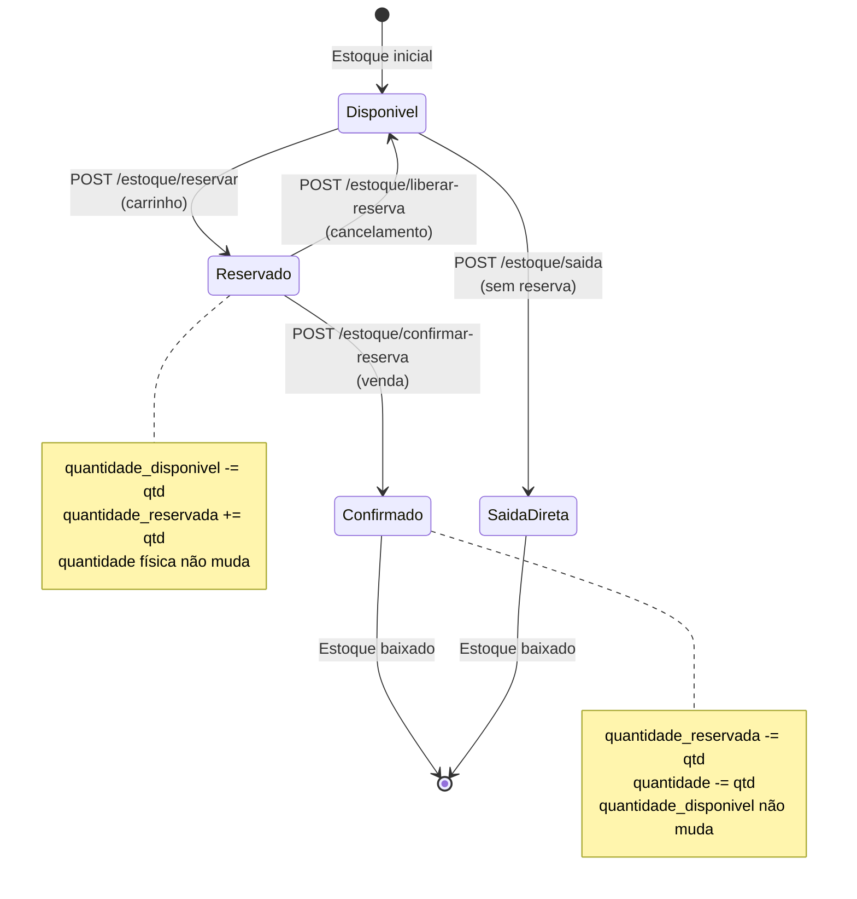

# 📐 Padrões e Convenções - Runas

**Data**: 26 de Maio de 2026  
**Versão**: 2.0.0  
**Tipo**: Documentação Técnica

---

## 📑 Índice

1. [Padrões de Autenticação](#51-padrões-de-autenticação)
2. [Padrões de Validação](#52-padrões-de-validação)
3. [Padrões de Resposta HTTP](#53-padrões-de-resposta)
4. [Padrões de Eventos (RabbitMQ)](#54-padrões-de-eventos-rabbitmq)
5. [Gestão de Reservas de Estoque](#61-gestão-de-reservas-de-estoque)
6. [Transações Distribuídas](#62-transações-distribuídas)
7. [Consistência Eventual](#63-consistência-eventual)
8. [Locks e Concorrência](#64-locks-e-concorrência)
9. [Idempotência](#65-idempotência)
10. [Fluxos de Erro Comuns](#7-fluxos-de-erro-comuns)
11. [Métricas e Monitoramento](#8-métricas-e-monitoramento)
12. [Diagrama de Estados](#10-diagrama-de-estados-do-estoque)
13. [Glossário Técnico](#12-glossário-técnico)

---

## 5.1. Padrões de Autenticação

**Todos os endpoints protegidos seguem o padrão:**

1. Cliente envia request com `Authorization: Bearer {token}`
2. API Gateway valida token com Auth Service
3. Gateway extrai `user_id` e `role` do token
4. Gateway propaga headers para microsserviços downstream
5. Microsserviço processa e retorna resposta

### Fluxo de Autenticação

```
┌─────────┐                ┌─────────┐                ┌──────────┐
│ Cliente │                │ Gateway │                │   Auth   │
└────┬────┘                └────┬────┘                └────┬─────┘
     │                          │                          │
     │ POST /auth/login         │                          │
     │─────────────────────────>│                          │
     │                          │ Validar credenciais      │
     │                          │─────────────────────────>│
     │                          │                          │
     │                          │ access_token + refresh   │
     │                          │<─────────────────────────│
     │ 200 OK {tokens}          │                          │
     │<─────────────────────────│                          │
     │                          │                          │
     │ GET /api/clientes        │                          │
     │ Authorization: Bearer... │                          │
     │─────────────────────────>│                          │
     │                          │ Validar token            │
     │                          │─────────────────────────>│
     │                          │ Token válido + user_id   │
     │                          │<─────────────────────────│
     │                          │                          │
     │                          │ GET /clientes            │
     │                          │ X-User-ID: uuid          │
     │                          │ X-User-Role: ADMIN       │
     │                          │────────────────────────> │
     │                          │                    Clientes
     │                          │                     Service
```

### Headers Propagados

```http
X-User-ID: uuid
X-User-Role: ADMIN
X-Request-ID: uuid
X-Correlation-ID: uuid
```

---

## 5.2. Padrões de Validação

**Ordem de validações (sempre nesta sequência):**

1. **Autenticação**: Token válido?
2. **Autorização**: Role adequada?
3. **Formato**: Campos obrigatórios, tipos corretos?
4. **Negócio**: CPF único, SKU único, estoque suficiente?
5. **Integridade Referencial**: Foreign keys existem?

### Exemplo de Validação em Camadas

```python
# 1. Autenticação (API Gateway)
if not token_valido:
    return 401 Unauthorized

# 2. Autorização (API Gateway)
if user_role not in ['ADMIN', 'GERENTE']:
    return 403 Forbidden

# 3. Validação de Formato (Pydantic)
class ClienteCreate(BaseModel):
    nome: str = Field(min_length=1, max_length=255)
    cpf_cnpj: str = Field(pattern=r'^\d{11}|\d{14}$')
    email: EmailStr
    telefone: str

# 4. Validação de Negócio (Service Layer)
if cliente_repository.existe_cpf(cpf):
    raise BusinessError("CPF já cadastrado")

# 5. Validação de Integridade (Repository)
if not categoria_exists(categoria_id):
    raise NotFoundError("Categoria não encontrada")
```

---

## 5.3. Padrões de Resposta

### Códigos HTTP Utilizados

| Código | Uso | Exemplo |
|--------|-----|---------|
| **200 OK** | Operação bem-sucedida (GET, PUT) | Buscar cliente, atualizar produto |
| **201 Created** | Recurso criado (POST) | Criar cliente, criar produto |
| **204 No Content** | Sucesso sem retorno (DELETE) | Desativar cliente |
| **400 Bad Request** | Erro de validação ou regra de negócio | CPF duplicado, estoque insuficiente |
| **401 Unauthorized** | Token inválido ou ausente | Token expirado |
| **403 Forbidden** | Sem permissão para a operação | VENDEDOR tentando criar cliente |
| **404 Not Found** | Recurso não encontrado | Cliente não existe |
| **409 Conflict** | Conflito (duplicidade) | SKU já cadastrado |
| **500 Internal Server Error** | Erro interno do servidor | Exceção não tratada |

### Formato de Resposta de Erro

```json
{
  "error": {
    "code": "ESTOQUE_INSUFICIENTE",
    "message": "Estoque insuficiente para o produto",
    "details": {
      "produto_id": "uuid",
      "quantidade_solicitada": 100,
      "quantidade_disponivel": 50
    },
    "timestamp": "2026-05-26T10:00:00Z",
    "request_id": "uuid"
  }
}
```

### Formato de Resposta Paginada

```json
{
  "items": [...],
  "total": 150,
  "page": 1,
  "limit": 20,
  "pages": 8,
  "has_next": true,
  "has_prev": false
}
```

---

## 5.4. Padrões de Eventos (RabbitMQ)

### Eventos Publicados

**Estoque**:
- `estoque.entrada` - Entrada de mercadoria
- `estoque.saida` - Saída direta (sem reserva)
- `estoque.reservado` - Estoque reservado (carrinho)
- `estoque.reserva_liberada` - Reserva liberada (cancelamento)
- `estoque.confirmado` - Reserva confirmada (venda)
- `estoque.alerta_baixo` - Estoque abaixo do mínimo
- `estoque.lote_vencido` - Lote vencido
- `estoque.lote_proximo_vencimento` - Lote próximo do vencimento
- `estoque.inventario_finalizado` - Inventário concluído

**Vendas/Pedidos**:
- `pedido.criado` - Pedido criado (carrinho finalizado)
- `pedido.pago` - Pagamento confirmado
- `pedido.pagamento_recusado` - Pagamento recusado
- `pedido.cancelado` - Pedido cancelado
- `venda.finalizada` - Venda paga e concluída
- `venda.fiada_criada` - Venda fiada registrada
- `venda.cancelada` - Venda cancelada

**Financeiro**:
- `pagamento.recebido` - Pagamento confirmado
- `conta.vencida` - Conta venceu
- `conta.recebida` - Conta foi paga

**Clientes**:
- `cliente.bloqueado` - Cliente foi bloqueado
- `cliente.desbloqueado` - Cliente foi desbloqueado

### Formato de Evento

```json
{
  "event_id": "uuid",
  "event_type": "estoque.alerta_baixo",
  "timestamp": "2026-05-26T10:00:00Z",
  "source": "estoque-service",
  "data": {
    "produto_id": "uuid",
    "quantidade_disponivel": 8,
    "estoque_minimo": 10
  },
  "metadata": {
    "user_id": "uuid",
    "request_id": "uuid"
  }
}
```

---

## 6.1. Gestão de Reservas de Estoque

### Problema

Evitar **baixa dupla de estoque** ao usar sistema de reservas.

### Solução Implementada

```
Estado Inicial:
- quantidade = 100
- quantidade_reservada = 0
- quantidade_disponivel = 100

1. Reservar (carrinho):
   quantidade_reservada += 5      → 5
   quantidade_disponivel -= 5     → 95
   quantidade permanece           → 100

2. Confirmar Reserva (venda):
   quantidade_reservada -= 5      → 0
   quantidade -= 5                → 95
   quantidade_disponivel permanece → 95

3. Cancelar (liberar reserva):
   quantidade_reservada -= 5      → 0
   quantidade_disponivel += 5     → 100
   quantidade permanece           → 100
```

### Regras

- `quantidade_disponivel = quantidade - quantidade_reservada`
- Reserva **NÃO** diminui `quantidade` física
- Confirmação diminui `quantidade` física E `quantidade_reservada`
- Cancelamento devolve para `quantidade_disponivel`

### Endpoints

| Endpoint | Quando Usar | Efeito |
|----------|-------------|--------|
| `POST /estoque/reservar` | Adicionar ao carrinho | Reserva (não baixa física) |
| `POST /estoque/confirmar-reserva` | Finalizar venda | Confirma e baixa física |
| `POST /estoque/liberar-reserva` | Cancelar carrinho | Libera reserva |
| `POST /estoque/saida` | Venda direta (sem carrinho) | Baixa física direta |

---

## 6.2. Transações Distribuídas

### Problema

Operações que envolvem múltiplos serviços (ex: venda fiada).

### Solução Atual (MVP)

- ✅ Chamadas síncronas sequenciais
- ✅ Rollback manual em caso de erro
- ✅ Logs detalhados para auditoria

**Exemplo de Rollback Manual**:
```python
try:
    # 1. Reservar estoque
    estoque_service.reservar(produto_id, quantidade)
    
    # 2. Criar conta a receber
    financeiro_service.criar_conta(cliente_id, valor)
    
    # 3. Debitar crédito
    clientes_service.debitar_credito(cliente_id, valor)
    
except Exception as e:
    # Rollback: Liberar reserva
    estoque_service.liberar_reserva(produto_id, quantidade)
    raise
```

### Solução Futura

- 🔄 Implementar **Saga Pattern**
- 🔄 Eventos de compensação
- 🔄 Idempotência em todos os endpoints

**Saga Orquestrada**:
```
Orquestrador
    ├─> Reservar Estoque
    ├─> Criar Conta
    ├─> Debitar Crédito
    └─> Confirmar Venda

Se falhar:
    ├─> Compensar: Liberar Estoque
    ├─> Compensar: Cancelar Conta
    └─> Compensar: Estornar Crédito
```

---

## 6.3. Consistência Eventual

### Conceito

Eventos assíncronos (RabbitMQ) podem ter delay:
- ⏱️ Notificações podem chegar com segundos de atraso
- ⏱️ Alertas de estoque não são em tempo real
- ⏱️ Sistema tolera inconsistência temporária

### Exemplo

```
10:00:00 - Venda finalizada
10:00:01 - Evento publicado no RabbitMQ
10:00:02 - Consumer processa evento
10:00:03 - Notificação enviada ao cliente

Delay total: 3 segundos
```

### Quando Aceitar

- ✅ Notificações (não crítico)
- ✅ Relatórios (pode ter delay)
- ✅ Alertas (segundos de atraso OK)

### Quando NÃO Aceitar

- ❌ Reserva de estoque (deve ser síncrono)
- ❌ Pagamento (deve ser síncrono)
- ❌ Validação de crédito (deve ser síncrono)

---

## 6.4. Locks e Concorrência

### Operações Críticas Usam Locks

```sql
-- Reserva de estoque
SELECT * FROM estoque
WHERE produto_id = ? AND variante_id = ?
FOR UPDATE;

-- Saída de estoque
SELECT * FROM estoque
WHERE id = ?
FOR UPDATE;

-- Ajuste de crédito
SELECT * FROM clientes
WHERE id = ?
FOR UPDATE;
```

### Por que FOR UPDATE?

**Sem lock (Race Condition)**:
```
Thread A: SELECT estoque (quantidade = 10)
Thread B: SELECT estoque (quantidade = 10)
Thread A: UPDATE estoque SET quantidade = 5
Thread B: UPDATE estoque SET quantidade = 5
Resultado: quantidade = 5 (ERRADO! Deveria ser 0)
```

**Com lock (Correto)**:
```
Thread A: SELECT ... FOR UPDATE (lock adquirido)
Thread B: SELECT ... FOR UPDATE (aguarda lock)
Thread A: UPDATE estoque SET quantidade = 5
Thread A: COMMIT (libera lock)
Thread B: SELECT ... FOR UPDATE (lock adquirido, quantidade = 5)
Thread B: UPDATE estoque SET quantidade = 0
Thread B: COMMIT
Resultado: quantidade = 0 (CORRETO!)
```

---

## 6.5. Idempotência

### Endpoints Idempotentes

- ✅ **GET**: Sempre idempotente (não altera estado)
- ✅ **PUT**: Atualização completa (mesmo resultado)
- ✅ **DELETE**: Soft delete (pode executar múltiplas vezes)

### Endpoints NÃO Idempotentes

- ❌ **POST**: Criar recurso (cria duplicata se executar 2x)

### Solução Futura

Usar `Idempotency-Key` header:

```http
POST /api/vendas
Idempotency-Key: abc123-def456-ghi789
Content-Type: application/json

{
  "cliente_id": "uuid",
  "itens": [...]
}
```

**Implementação**:
```python
def criar_venda(request):
    idempotency_key = request.headers.get('Idempotency-Key')
    
    # Verificar se já foi processado
    if cache.exists(idempotency_key):
        return cache.get(idempotency_key)
    
    # Processar venda
    venda = vendas_service.criar(request.data)
    
    # Armazenar resultado
    cache.set(idempotency_key, venda, ttl=86400)  # 24h
    
    return venda
```

---

## 7. Fluxos de Erro Comuns

### 7.1. Token Expirado

```
Cliente → Gateway: Request com token expirado
Gateway → Auth: Validar token
Auth → Gateway: 401 Token expirado
Gateway → Cliente: 401 Unauthorized

Cliente → Gateway: POST /auth/refresh (refresh_token)
Gateway → Auth: Renovar token
Auth → Gateway: Novo access_token
Gateway → Cliente: 200 OK {access_token}
```

### 7.2. Estoque Insuficiente

```
Cliente → Gateway: POST /vendas (quantidade: 100)
Gateway → Vendas: Criar venda
Vendas → Estoque: Reservar 100 unidades
Estoque → Estoque: Verificar disponibilidade (apenas 50)
Estoque → Vendas: 400 Estoque insuficiente
Vendas → Gateway: 400 Estoque insuficiente
Gateway → Cliente: 400 Bad Request
```

### 7.3. Cliente Bloqueado

```
Cliente → Gateway: POST /vendas (tipo: FIADO)
Gateway → Vendas: Criar venda fiada
Vendas → Clientes: Verificar cliente
Clientes → Vendas: Cliente bloqueado
Vendas → Gateway: 400 Cliente bloqueado
Gateway → Cliente: 400 Bad Request
```

---

## 8. Métricas e Monitoramento

### 8.1. Métricas Importantes

**Por Endpoint**:
- Tempo de resposta (p50, p95, p99)
- Taxa de erro (4xx, 5xx)
- Throughput (requests/segundo)

**Por Serviço**:
- Disponibilidade (uptime)
- Latência de comunicação inter-serviços
- Tamanho da fila de eventos (RabbitMQ)

**Por Operação de Negócio**:
- Tempo médio de criação de venda
- Taxa de falha em reserva de estoque
- Tempo de processamento de inventário

### 8.2. Logs Estruturados

**Todos os serviços usam structlog**:

```json
{
  "timestamp": "2026-05-26T10:30:00Z",
  "service": "estoque",
  "level": "info",
  "event": "estoque.saida",
  "produto_id": "uuid",
  "quantidade": 50,
  "usuario_id": "uuid",
  "request_id": "uuid",
  "duration_ms": 45
}
```

---

## 10. Diagrama de Estados do Estoque

### 10.1. Máquina de Estados - Reserva de Estoque



### 10.2. Tabela Comparativa: Operações de Estoque

| Operação | Endpoint | Quando Usar | quantidade | quantidade_reservada | quantidade_disponivel |
|----------|----------|-------------|------------|---------------------|----------------------|
| **Entrada** | `POST /estoque/entrada` | Compra de fornecedor | +100 | 0 | +100 |
| **Reservar** | `POST /estoque/reservar` | Adicionar ao carrinho | 0 | +10 | -10 |
| **Liberar Reserva** | `POST /estoque/liberar-reserva` | Cancelar carrinho | 0 | -10 | +10 |
| **Confirmar Reserva** | `POST /estoque/confirmar-reserva` | Finalizar venda | -10 | -10 | 0 |
| **Saída Direta** | `POST /estoque/saida` | Venda sem carrinho | -10 | 0 | -10 |
| **Ajuste** | `POST /estoque/ajustar` | Inventário | ±X | 0 | ±X |

---

## 12. Glossário Técnico

| Termo | Definição |
|-------|-----------|
| **FOR UPDATE** | Lock pessimista em SELECT para evitar race conditions |
| **TTL** | Time To Live - Tempo de vida de um recurso (ex: carrinho) |
| **Webhook** | Callback HTTP para notificação de eventos externos |
| **Race Condition** | Condição de corrida quando múltiplas threads acessam mesmo recurso |
| **Idempotência** | Operação que pode ser executada múltiplas vezes com mesmo resultado |
| **Saga Pattern** | Padrão para transações distribuídas com compensação |
| **Circuit Breaker** | Padrão para evitar cascata de falhas entre serviços |
| **Eventual Consistency** | Consistência eventual em sistemas distribuídos |
| **FIFO** | First In, First Out - Primeiro que entra, primeiro que sai |
| **Soft Delete** | Desativação lógica ao invés de exclusão física |
| **Rollback** | Reverter operações em caso de erro |
| **Compensação** | Operação inversa para desfazer transação |
| **Orquestração** | Coordenação centralizada de serviços |
| **Coreografia** | Serviços reagem a eventos sem coordenador central |
| **Consumer** | Serviço que consome eventos de uma fila |
| **Publisher** | Serviço que publica eventos em uma fila |
| **Exchange** | Roteador de mensagens no RabbitMQ |
| **Routing Key** | Chave para rotear mensagens no RabbitMQ |
| **Dead Letter Queue** | Fila para mensagens que falharam no processamento |
| **Backoff Exponencial** | Aumentar tempo de espera entre retries |

---

## 📚 Documentação Relacionada

- **[Clientes](./clientes.md)** - Operações de cliente
- **[Produtos](./produtos.md)** - Operações de produto
- **[Estoque](./estoque.md)** - Operações de estoque
- **[Vendas](./vendas.md)** - Operações de venda
- **[Fluxos Integrados](./fluxos-integrados.md)** - Fluxos completos
- **[Índice Geral](./README.md)** - Voltar ao índice

---

**Última atualização**: 26 de Maio de 2026  
**Versão**: 2.0.0  
**Mantido por**: Equipe DenebCorp

---

<div align="center">

**[⬆ Voltar ao topo](#-padrões-e-convenções---runas)**

</div>
