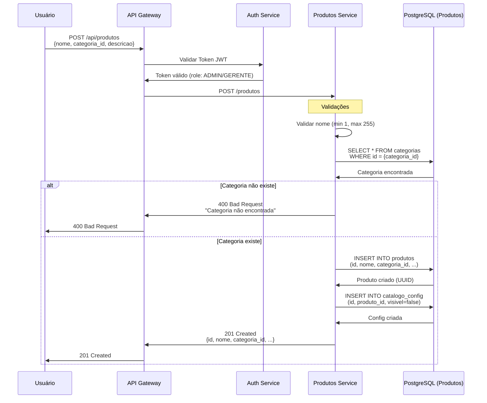
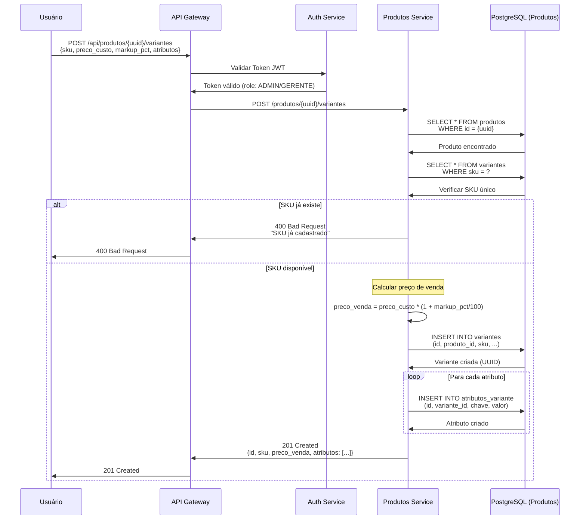
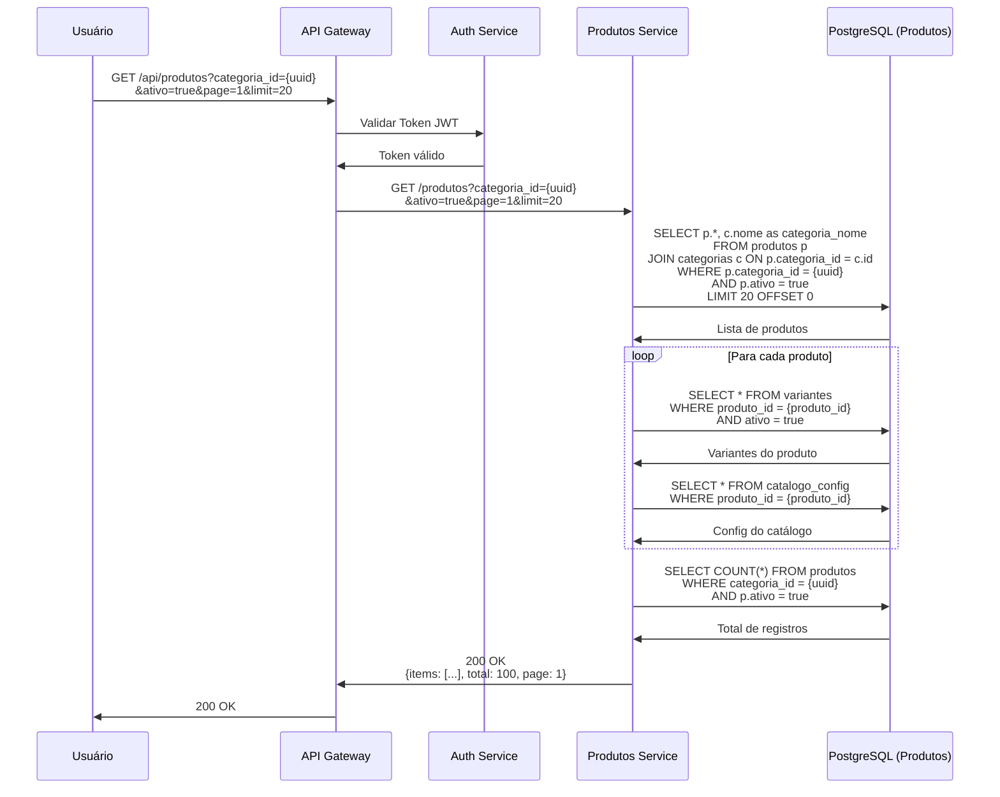
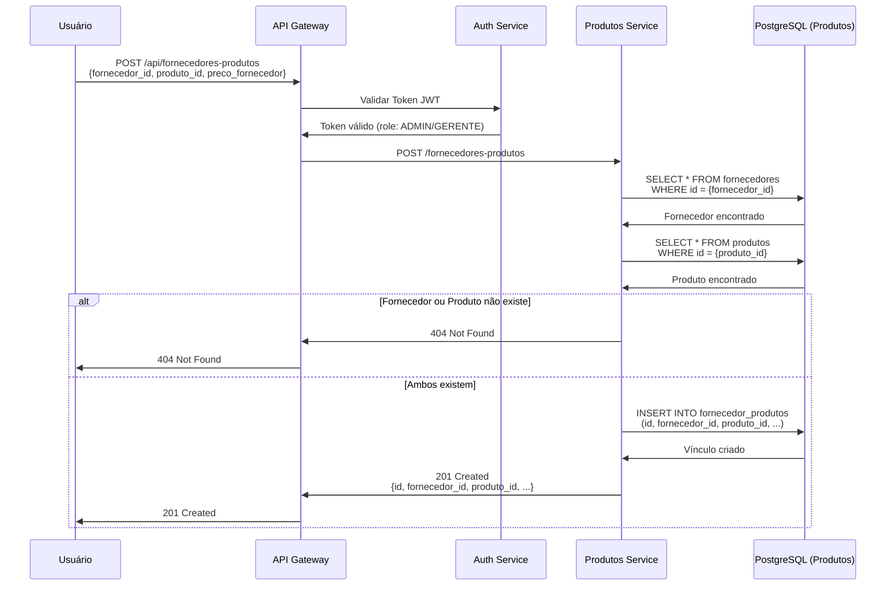
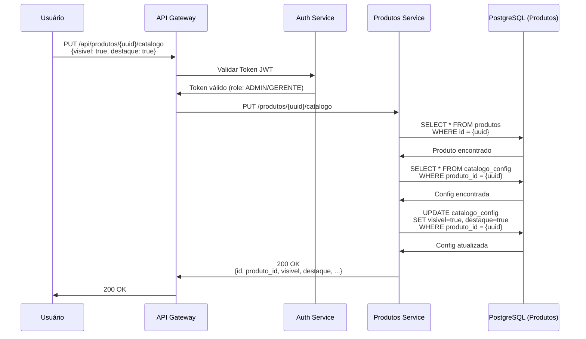

# 📦 Diagramas de Sequência - Produtos

**Data**: 26 de Maio de 2026  
**Versão**: 2.0.0  
**Domínio**: Produtos

---

## 📑 Índice

1. [Criar Produto](#21-criar-produto)
2. [Criar Variante](#22-criar-variante)
3. [Listar Produtos com Filtros](#23-listar-produtos-com-filtros)
4. [Vincular Fornecedor ao Produto](#24-vincular-fornecedor-ao-produto)
5. [Atualizar Configuração de Catálogo](#25-atualizar-configuração-de-catálogo)

---

## 2.1. Criar Produto (POST /api/produtos)



### Campos do Produto

```json
{
  "nome": "Coca-Cola 2L",
  "categoria_id": "uuid",
  "descricao": "Refrigerante Coca-Cola 2 litros",
  "marca": "Coca-Cola",
  "codigo_barras": "7894900011517",
  "unidade_medida": "UN",
  "ativo": true
}
```

### Regras de Negócio

- Nome é obrigatório (1-255 caracteres)
- Categoria deve existir no sistema
- Produto criado com `ativo = true` por padrão
- Configuração de catálogo criada automaticamente com `visivel = false`
- Código de barras é opcional mas deve ser único se fornecido

---

## 2.2. Criar Variante (POST /api/produtos/{id}/variantes)



### O que são Variantes?

Variantes representam diferentes versões de um mesmo produto. Exemplos:

**Produto**: Camiseta Básica
- **Variante 1**: Tamanho P, Cor Branca (SKU: CAM-P-BCO)
- **Variante 2**: Tamanho M, Cor Preta (SKU: CAM-M-PTO)
- **Variante 3**: Tamanho G, Cor Azul (SKU: CAM-G-AZL)

**Produto**: Refrigerante Coca-Cola
- **Variante 1**: 350ml Lata (SKU: COCA-350-LT)
- **Variante 2**: 600ml PET (SKU: COCA-600-PT)
- **Variante 3**: 2L PET (SKU: COCA-2L-PT)

### Campos da Variante

```json
{
  "sku": "COCA-2L-PT",
  "preco_custo": 5.50,
  "markup_pct": 45.45,
  "preco_venda": 8.00,
  "codigo_barras": "7894900011517",
  "atributos": [
    {
      "chave": "tamanho",
      "valor": "2L"
    },
    {
      "chave": "embalagem",
      "valor": "PET"
    }
  ],
  "ativo": true
}
```

### Cálculo de Preço

```
preco_venda = preco_custo * (1 + markup_pct / 100)

Exemplo:
preco_custo = R$ 5,50
markup_pct = 45,45%
preco_venda = 5,50 * (1 + 45,45/100)
preco_venda = 5,50 * 1,4545
preco_venda = R$ 8,00
```

### Regras de Negócio

- SKU deve ser único no sistema
- Preço de venda é calculado automaticamente baseado no markup
- Atributos são flexíveis (chave-valor)
- Código de barras é opcional mas deve ser único se fornecido
- Variante criada com `ativo = true` por padrão

---

## 2.3. Listar Produtos com Filtros (GET /api/produtos)



### Filtros Disponíveis

- `nome` - Busca parcial (case-insensitive)
- `categoria_id` - Filtrar por categoria
- `marca` - Busca parcial
- `codigo_barras` - Busca exata
- `ativo` - true/false
- `visivel_catalogo` - Produtos visíveis no catálogo online
- `page` - Número da página (padrão: 1)
- `limit` - Itens por página (padrão: 20, máx: 100)

### Resposta Paginada

```json
{
  "items": [
    {
      "id": "uuid",
      "nome": "Coca-Cola",
      "categoria_id": "uuid",
      "categoria_nome": "Refrigerantes",
      "descricao": "Refrigerante Coca-Cola",
      "marca": "Coca-Cola",
      "ativo": true,
      "variantes": [
        {
          "id": "uuid",
          "sku": "COCA-2L-PT",
          "preco_venda": 8.00,
          "atributos": [
            {"chave": "tamanho", "valor": "2L"}
          ]
        }
      ],
      "catalogo": {
        "visivel": true,
        "destaque": false,
        "ordem": 1
      }
    }
  ],
  "total": 100,
  "page": 1,
  "limit": 20,
  "pages": 5
}
```

---

## 2.4. Vincular Fornecedor ao Produto (POST /api/fornecedores-produtos)



### Gestão de Fornecedores

Um produto pode ter múltiplos fornecedores com preços diferentes.

**Exemplo**:
```json
{
  "produto_id": "uuid-coca-2l",
  "fornecedores": [
    {
      "fornecedor_id": "uuid-distribuidora-a",
      "fornecedor_nome": "Distribuidora A",
      "preco_fornecedor": 5.50,
      "prazo_entrega_dias": 2,
      "principal": true
    },
    {
      "fornecedor_id": "uuid-distribuidora-b",
      "fornecedor_nome": "Distribuidora B",
      "preco_fornecedor": 5.80,
      "prazo_entrega_dias": 1,
      "principal": false
    }
  ]
}
```

### Campos do Vínculo

```json
{
  "fornecedor_id": "uuid",
  "produto_id": "uuid",
  "preco_fornecedor": 5.50,
  "prazo_entrega_dias": 2,
  "quantidade_minima": 10,
  "principal": true,
  "ativo": true
}
```

### Regras de Negócio

- Produto pode ter múltiplos fornecedores
- Apenas um fornecedor pode ser marcado como `principal`
- Preço do fornecedor é usado como referência para cálculo de markup
- Prazo de entrega ajuda no planejamento de reposição

---

## 2.5. Atualizar Configuração de Catálogo (PUT /api/produtos/{id}/catalogo)



### Configuração de Catálogo

Controla como o produto aparece no catálogo online/app.

**Campos**:
```json
{
  "produto_id": "uuid",
  "visivel": true,
  "destaque": true,
  "ordem": 1,
  "imagem_url": "https://cdn.runas.com/produtos/coca-2l.jpg",
  "descricao_curta": "Refrigerante Coca-Cola 2L",
  "tags": ["refrigerante", "coca-cola", "bebida"]
}
```

### Regras de Exibição

- `visivel = false`: Produto não aparece no catálogo (padrão ao criar)
- `visivel = true`: Produto aparece no catálogo
- `destaque = true`: Produto aparece em seção de destaques
- `ordem`: Define ordem de exibição (menor número = maior prioridade)

### Casos de Uso

1. **Lançamento de Produto**:
   - Criar produto com `visivel = false`
   - Configurar estoque, preços, imagens
   - Quando pronto: `visivel = true`

2. **Promoção**:
   - Marcar produto como `destaque = true`
   - Ajustar `ordem` para aparecer primeiro
   - Após promoção: `destaque = false`

3. **Produto Descontinuado**:
   - `visivel = false` (não aparece mais no catálogo)
   - `ativo = true` (ainda pode vender estoque restante)

---

## 📊 Resumo de Endpoints

| Método | Endpoint | Descrição | Permissão |
|--------|----------|-----------|-----------|
| POST | `/api/produtos` | Criar produto | ADMIN/GERENTE |
| GET | `/api/produtos` | Listar produtos | Todos |
| GET | `/api/produtos/{id}` | Buscar por ID | Todos |
| PUT | `/api/produtos/{id}` | Atualizar produto | ADMIN/GERENTE |
| DELETE | `/api/produtos/{id}` | Desativar produto | ADMIN |
| POST | `/api/produtos/{id}/variantes` | Criar variante | ADMIN/GERENTE |
| PUT | `/api/produtos/{id}/variantes/{variante_id}` | Atualizar variante | ADMIN/GERENTE |
| POST | `/api/fornecedores-produtos` | Vincular fornecedor | ADMIN/GERENTE |
| PUT | `/api/produtos/{id}/catalogo` | Config catálogo | ADMIN/GERENTE |

---

## 🔐 Permissões por Role

| Operação | ADMIN | GERENTE | VENDEDOR | OPERADOR |
|----------|-------|---------|----------|----------|
| Criar produto | ✅ | ✅ | ❌ | ❌ |
| Listar produtos | ✅ | ✅ | ✅ | ✅ |
| Buscar produto | ✅ | ✅ | ✅ | ✅ |
| Atualizar produto | ✅ | ✅ | ❌ | ❌ |
| Desativar produto | ✅ | ❌ | ❌ | ❌ |
| Gerenciar variantes | ✅ | ✅ | ❌ | ❌ |
| Gerenciar fornecedores | ✅ | ✅ | ❌ | ❌ |
| Config catálogo | ✅ | ✅ | ❌ | ❌ |

---

## 📚 Documentação Relacionada

- **[Regras de Negócio - Produtos](../../../11-regras-negocio/produtos.md)** - Regras detalhadas
- **[API Reference - Produtos](../../../10-api-reference/mapeamento-rotas.md#produtos)** - Referência completa
- **[Estoque](./estoque.md)** - Gestão de estoque de produtos
- **[Índice Geral](./README.md)** - Voltar ao índice

---

**Última atualização**: 26 de Maio de 2026  
**Versão**: 2.0.0  
**Mantido por**: Equipe DenebCorp

---

<div align="center">

**[⬆ Voltar ao topo](#-diagramas-de-sequência---produtos)**

</div>
