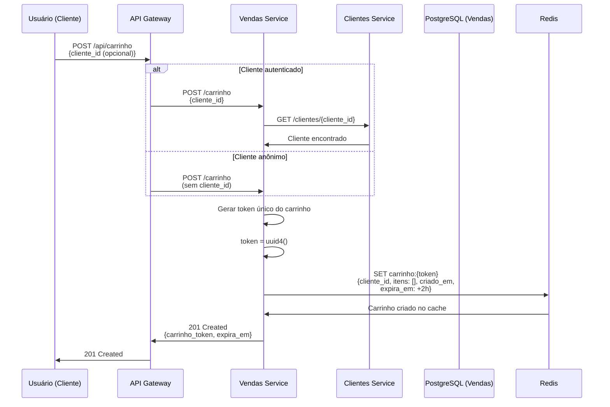
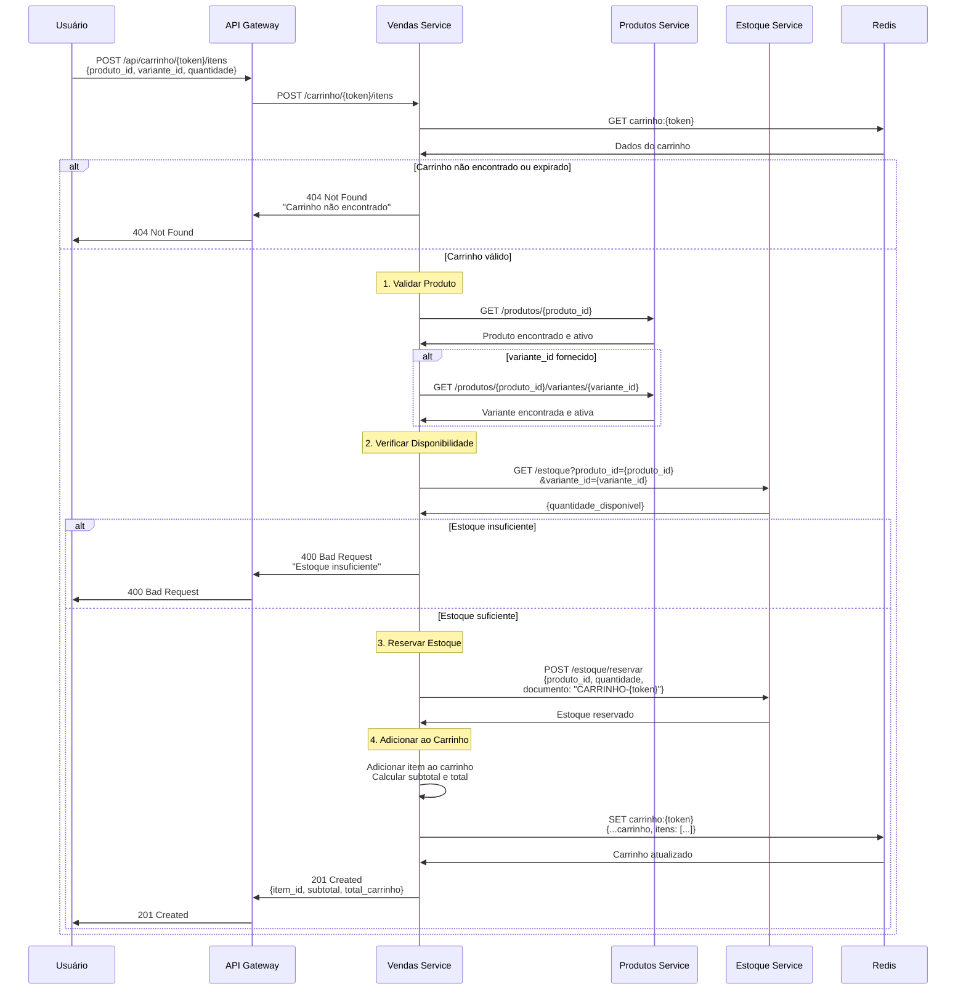
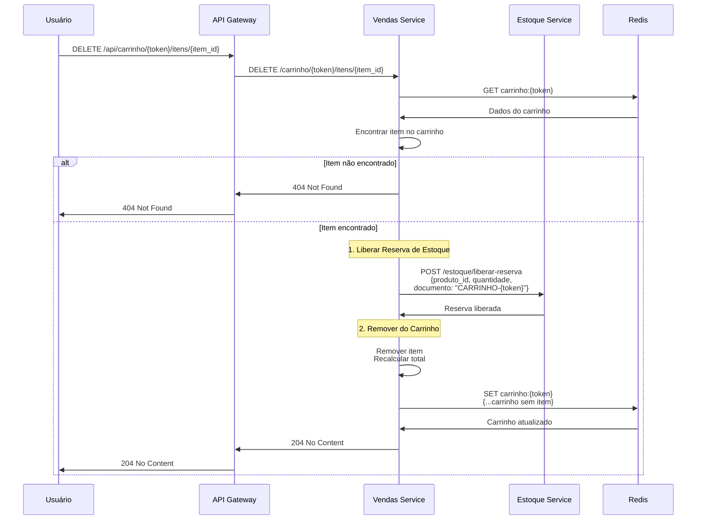
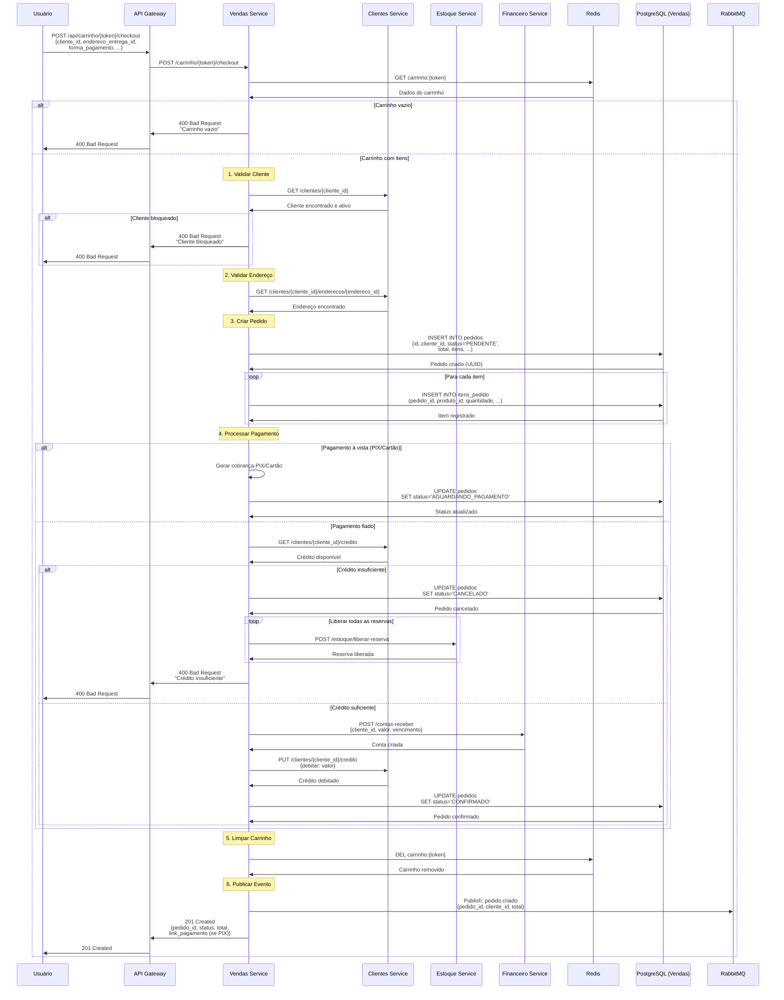
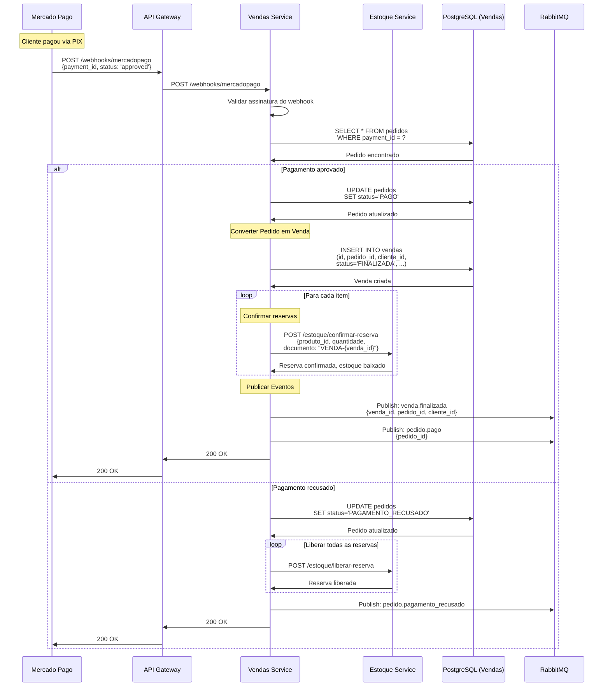
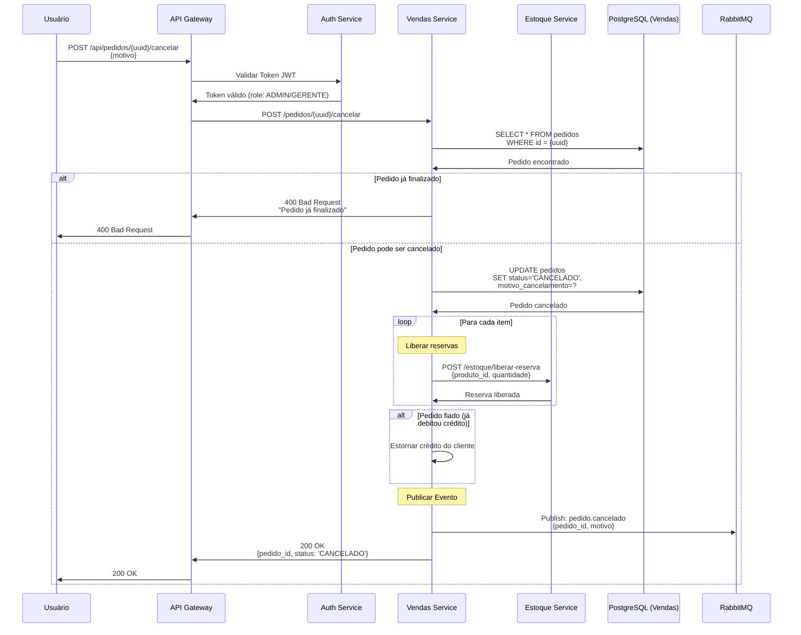

# 🛒 Diagramas de Sequência - Vendas

**Data**: 26 de Maio de 2026  
**Versão**: 2.0.0  
**Domínio**: Vendas (Carrinho e Pedidos)

---

## 📑 Índice

1. [Criar Carrinho](#391-criar-carrinho)
2. [Adicionar Item ao Carrinho](#392-adicionar-item-ao-carrinho)
3. [Remover Item do Carrinho](#393-remover-item-do-carrinho)
4. [Finalizar Carrinho (Checkout)](#394-finalizar-carrinho-criar-pedido)
5. [Confirmar Pagamento (Webhook)](#395-confirmar-pagamento-e-converter-pedido-em-venda)
6. [Cancelar Pedido](#396-cancelar-pedido)

---

## 3.9.1. Criar Carrinho (POST /api/carrinho)



### Carrinho no Redis

**Por que Redis?**
- ✅ **Performance**: Acesso ultra-rápido (in-memory)
- ✅ **TTL**: Expiração automática após 2 horas
- ✅ **Escalabilidade**: Não sobrecarrega banco principal
- ✅ **Temporário**: Carrinho é transitório, não precisa persistir

**Estrutura do Carrinho**:
```json
{
  "token": "abc123-def456-ghi789",
  "cliente_id": "uuid",
  "itens": [],
  "total": 0.00,
  "criado_em": "2026-05-26T10:00:00Z",
  "expira_em": "2026-05-26T12:00:00Z"
}
```

### Carrinho Anônimo vs Autenticado

**Anônimo**:
- Não requer login
- Identificado apenas por token
- Expira em 2 horas
- Não salva histórico

**Autenticado**:
- Vinculado ao cliente
- Pode ser recuperado em outro dispositivo
- Histórico de carrinhos abandonados
- Pode enviar lembretes

---

## 3.9.2. Adicionar Item ao Carrinho (POST /api/carrinho/{token}/itens)



### Fluxo de Validações

1. **Carrinho existe?** → 404 se não encontrado
2. **Produto ativo?** → 400 se inativo
3. **Variante ativa?** → 400 se inativa
4. **Estoque disponível?** → 400 se insuficiente
5. **Reserva OK?** → Adiciona ao carrinho

### Item do Carrinho

```json
{
  "item_id": "uuid",
  "produto_id": "uuid",
  "produto_nome": "Coca-Cola 2L",
  "variante_id": "uuid",
  "sku": "COCA-2L-PT",
  "quantidade": 2,
  "preco_unitario": 8.00,
  "subtotal": 16.00
}
```

### Carrinho Atualizado

```json
{
  "token": "abc123",
  "cliente_id": "uuid",
  "itens": [
    {
      "item_id": "uuid-1",
      "produto_nome": "Coca-Cola 2L",
      "quantidade": 2,
      "preco_unitario": 8.00,
      "subtotal": 16.00
    },
    {
      "item_id": "uuid-2",
      "produto_nome": "Guaraná 2L",
      "quantidade": 1,
      "preco_unitario": 7.00,
      "subtotal": 7.00
    }
  ],
  "total": 23.00,
  "expira_em": "2026-05-26T12:00:00Z"
}
```

---

## 3.9.3. Remover Item do Carrinho (DELETE /api/carrinho/{token}/itens/{item_id})



### Importante: Liberar Reserva

Ao remover item do carrinho, **sempre liberar a reserva de estoque**:
- Devolve quantidade para `quantidade_disponivel`
- Diminui `quantidade_reservada`
- Permite que outros clientes comprem

### Atualizar Quantidade

Para atualizar quantidade (não remover):
```http
PUT /api/carrinho/{token}/itens/{item_id}
{
  "quantidade": 3
}
```

**Fluxo**:
1. Se aumentar: Reservar diferença adicional
2. Se diminuir: Liberar diferença
3. Atualizar carrinho

---

## 3.9.4. Finalizar Carrinho (Criar Pedido) (POST /api/carrinho/{token}/checkout)



### Formas de Pagamento

**1. PIX (Mercado Pago)**:
- Gera QR Code
- Status: `AGUARDANDO_PAGAMENTO`
- Aguarda webhook de confirmação
- Reserva mantida até pagamento ou expiração

**2. Cartão de Crédito/Débito**:
- Integração com gateway de pagamento
- Status: `AGUARDANDO_PAGAMENTO`
- Confirmação via webhook

**3. Fiado (Crédito)**:
- Verifica crédito disponível do cliente
- Debita crédito imediatamente
- Cria conta a receber
- Status: `CONFIRMADO` (já pago via crédito)

**4. Dinheiro (Balcão)**:
- Pagamento presencial
- Status: `CONFIRMADO` imediatamente
- Confirma reservas e baixa estoque

### Estados do Pedido

```
PENDENTE → Pedido criado, aguardando processamento
AGUARDANDO_PAGAMENTO → Aguardando confirmação de pagamento
PAGO → Pagamento confirmado
CONFIRMADO → Pedido confirmado (fiado ou dinheiro)
CANCELADO → Pedido cancelado
PAGAMENTO_RECUSADO → Pagamento recusado
```

### Resposta do Checkout

```json
{
  "pedido_id": "uuid",
  "status": "AGUARDANDO_PAGAMENTO",
  "total": 23.00,
  "forma_pagamento": "PIX",
  "link_pagamento": "https://mercadopago.com/pix/abc123",
  "qr_code": "00020126....",
  "expira_em": "2026-05-26T10:30:00Z"
}
```

---

## 3.9.5. Confirmar Pagamento e Converter Pedido em Venda (Webhook)



### Webhook do Mercado Pago

**Segurança**:
- Validar assinatura HMAC-SHA256
- Verificar IP de origem
- Idempotência (processar apenas uma vez)

**Payload do Webhook**:
```json
{
  "id": "payment-id",
  "type": "payment",
  "data": {
    "id": "payment-id"
  },
  "date_created": "2026-05-26T10:15:00Z",
  "action": "payment.updated"
}
```

**Buscar Detalhes do Pagamento**:
```http
GET https://api.mercadopago.com/v1/payments/{payment_id}
Authorization: Bearer ACCESS_TOKEN
```

### Pedido → Venda

**Diferença**:
- **Pedido**: Intenção de compra (pode ser cancelado)
- **Venda**: Transação finalizada (estoque baixado)

**Conversão**:
1. Pedido com status `PAGO`
2. Criar registro de Venda
3. Confirmar todas as reservas (baixa física)
4. Publicar eventos
5. Enviar notificação ao cliente

---

## 3.9.6. Cancelar Pedido (POST /api/pedidos/{id}/cancelar)



### Regras de Cancelamento

**Pode cancelar**:
- ✅ Pedido `PENDENTE`
- ✅ Pedido `AGUARDANDO_PAGAMENTO`
- ✅ Pedido `PAGAMENTO_RECUSADO`

**NÃO pode cancelar**:
- ❌ Pedido `PAGO` (já virou venda)
- ❌ Pedido `CONFIRMADO` e já entregue
- ❌ Pedido `CANCELADO` (já está cancelado)

### Estorno de Crédito

Se pedido fiado foi confirmado:
1. Estornar valor no crédito do cliente
2. Cancelar conta a receber
3. Liberar reservas de estoque

### Motivos de Cancelamento

```json
{
  "motivo": "Cliente desistiu",
  "observacao": "Cliente solicitou cancelamento por telefone",
  "cancelado_por": "admin@runas.com",
  "cancelado_em": "2026-05-26T11:00:00Z"
}
```

---

## 📊 Resumo de Endpoints

| Método | Endpoint | Descrição | Permissão |
|--------|----------|-----------|-----------|
| POST | `/api/carrinho` | Criar carrinho | Público |
| GET | `/api/carrinho/{token}` | Consultar carrinho | Público |
| POST | `/api/carrinho/{token}/itens` | Adicionar item | Público |
| PUT | `/api/carrinho/{token}/itens/{item_id}` | Atualizar quantidade | Público |
| DELETE | `/api/carrinho/{token}/itens/{item_id}` | Remover item | Público |
| POST | `/api/carrinho/{token}/checkout` | Finalizar (criar pedido) | Público |
| GET | `/api/pedidos` | Listar pedidos | ADMIN/GERENTE |
| GET | `/api/pedidos/{id}` | Consultar pedido | Todos |
| POST | `/api/pedidos/{id}/cancelar` | Cancelar pedido | ADMIN/GERENTE |
| POST | `/webhooks/mercadopago` | Webhook pagamento | Sistema |

---

## 🔐 Permissões por Role

| Operação | ADMIN | GERENTE | VENDEDOR | OPERADOR | PÚBLICO |
|----------|-------|---------|----------|----------|---------|
| Criar carrinho | ✅ | ✅ | ✅ | ✅ | ✅ |
| Adicionar item | ✅ | ✅ | ✅ | ✅ | ✅ |
| Checkout | ✅ | ✅ | ✅ | ✅ | ✅ |
| Listar pedidos | ✅ | ✅ | ❌ | ❌ | ❌ |
| Cancelar pedido | ✅ | ✅ | ❌ | ❌ | ❌ |
| Ver próprios pedidos | ✅ | ✅ | ✅ | ✅ | ✅ |

---

## 📚 Documentação Relacionada

- **[Regras de Negócio - Vendas](../../../11-regras-negocio/vendas.md)** - Regras detalhadas
- **[API Reference - Vendas](../../../10-api-reference/mapeamento-rotas.md#vendas)** - Referência completa
- **[Estoque](./estoque.md)** - Como vendas interagem com estoque
- **[Fluxos Integrados](./fluxos-integrados.md)** - Fluxos completos de venda
- **[Índice Geral](./README.md)** - Voltar ao índice

---

**Última atualização**: 26 de Maio de 2026  
**Versão**: 2.0.0  
**Mantido por**: Equipe DenebCorp

---

<div align="center">

**[⬆ Voltar ao topo](#-diagramas-de-sequência---vendas)**

</div>
